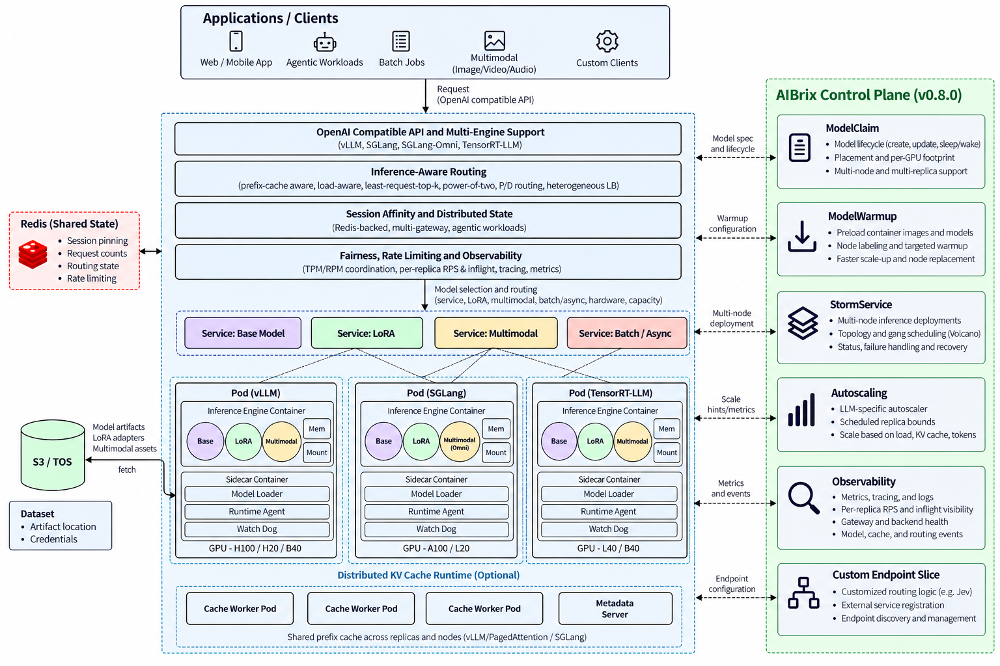

# AIBrix

<p align="center">
  <a href="LICENSE"></a>
  <a href="https://aibrix.readthedocs.io/latest/"></a>
  <a href="https://github.com/vllm-project/aibrix/releases/latest"></a>
  <a href="https://vllm-dev.slack.com/archives/C08EQ883CSV"></a>
</p>

<p align="center">
  <a href="https://aibrix.readthedocs.io/latest/"><b>Documentation</b></a> ·
  <a href="https://aibrix.github.io/"><b>Blog</b></a> ·
  <a href="https://arxiv.org/abs/2504.03648"><b>White paper</b></a> ·
  <a href="https://x.com/vllm_project"><b>X</b></a> ·
  <a href="https://vllm-dev.slack.com/archives/C08EQ883CSV"><b>Slack</b></a>
</p>

AIBrix is a Kubernetes control plane for production LLM inference. You bring the engine — vLLM, SGLang, or TensorRT-LLM — and AIBrix routes each request from live engine state, scales on inference metrics, and manages models, LoRA adapters, and KV cache.

Use it when you run many models or replicas, mix GPU types, or need to hold cost and latency targets.

## Features

| Capability | What it does |
| --- | --- |
| [Gateway and routing](https://aibrix.readthedocs.io/latest/features/gateway-routing/gateway-plugins.html) | OpenAI-compatible API. Picks a pod from live engine state, including prefix-cache, load, and [prefill/decode](https://aibrix.readthedocs.io/latest/features/gateway-routing/pd-disaggregation.html) placement, with session affinity for agentic workloads. |
| [Multi-engine](https://aibrix.readthedocs.io/latest/features/model-serving/multi-engine.html) | Serve vLLM, SGLang, and TensorRT-LLM behind one gateway. |
| [LoRA](https://aibrix.readthedocs.io/latest/features/model-serving/lora-dynamic-loading.html) | Pack many low-rank adapters onto shared base-model pods. |
| [Model lifecycle](https://aibrix.readthedocs.io/latest/features/model-serving/model-claim.html) | Declare models with ModelClaim, and [preload images and weights](https://aibrix.readthedocs.io/latest/features/model-serving/model-warmup.html) with ModelWarmup so scale-up is faster. |
| [Autoscaling](https://aibrix.readthedocs.io/latest/features/scaling-performance/autoscaling/autoscaling.html) | Scale replicas on engine metrics such as queue depth, KV cache, and tokens. |
| [Distributed inference](https://aibrix.readthedocs.io/latest/features/model-serving/multi-node-inference.html) | Run multi-node and multi-role deployments, including prefill/decode, with StormService. |
| [Distributed KV cache](https://aibrix.readthedocs.io/latest/features/scaling-performance/kvcache-offloading.html) | Offload KV cache and reuse it across engines. |
| [Heterogeneous GPUs](https://aibrix.readthedocs.io/latest/features/model-serving/heterogeneous-gpu.html) | Mix GPU types and still target cost and SLO. Experimental. |
| [Runtime](https://aibrix.readthedocs.io/latest/features/model-serving/runtime.html) | Sidecar that downloads weights, loads and unloads adapters, and normalizes engine metrics. |

## Architecture



Requests hit an OpenAI-compatible gateway and go straight to an engine pod. Kubernetes controllers decide what should be running: model lifecycle, warmup, multi-node topology, autoscaling, and observability. The [architecture guide](https://aibrix.readthedocs.io/latest/designs/architecture.html) walks through both planes.

## Quick start

These commands install AIBrix, including its Envoy Gateway dependency, into the cluster your current `kubectl` context points at. KubeRay is included and is only required for Ray-based multi-node inference.

The snippet installs the latest release, [v0.8.0](https://github.com/vllm-project/aibrix/releases/tag/v0.8.0). Change `VERSION` to install a different release.

### Install a release

```shell
VERSION=v0.8.0

# Dependencies (Envoy Gateway, KubeRay, and friends)
kubectl apply -f "https://github.com/vllm-project/aibrix/releases/download/${VERSION}/aibrix-dependency-${VERSION}.yaml" --server-side

# CRDs ship separately so uninstalling the operator does not delete user resources
kubectl apply -f "https://github.com/vllm-project/aibrix/releases/download/${VERSION}/aibrix-core-crds-${VERSION}.yaml" --server-side

# Controllers, gateway plugins, and supporting services
kubectl apply -f "https://github.com/vllm-project/aibrix/releases/download/${VERSION}/aibrix-core-${VERSION}.yaml"

kubectl get pods -n aibrix-system
```

When the pods are ready, deploy a model and call the gateway. The [quickstart](https://aibrix.readthedocs.io/latest/getting_started/quickstart.html) has a base-model manifest and the OpenAI-compatible curl commands. Helm install steps are in the [installation guide](https://aibrix.readthedocs.io/latest/getting_started/installation/installation.html).

### Install from this checkout

Images in `config/default` are tagged `nightly`.

```shell
git clone https://github.com/vllm-project/aibrix.git
cd aibrix

kubectl apply -k config/dependency --server-side
kubectl apply -k config/crd --server-side
kubectl apply -k config/default
```

## Documentation

Full guides live at [aibrix.readthedocs.io](https://aibrix.readthedocs.io/latest/).

| You want to | Start here |
| --- | --- |
| Serve a first model | [Overview](https://aibrix.readthedocs.io/latest/getting_started/overview.html), then the [quickstart](https://aibrix.readthedocs.io/latest/getting_started/quickstart.html) |
| Make a running deployment cheaper | [Autoscaling](https://aibrix.readthedocs.io/latest/features/scaling-performance/autoscaling/autoscaling.html), [LoRA](https://aibrix.readthedocs.io/latest/features/model-serving/lora-dynamic-loading.html), [KV cache](https://aibrix.readthedocs.io/latest/features/scaling-performance/kvcache-offloading.html), [observability](https://aibrix.readthedocs.io/latest/production/observability.html) |
| Hit scale or latency targets | [Prefill/decode](https://aibrix.readthedocs.io/latest/features/gateway-routing/pd-disaggregation.html), [multi-node inference](https://aibrix.readthedocs.io/latest/features/model-serving/multi-node-inference.html), [heterogeneous GPUs](https://aibrix.readthedocs.io/latest/features/model-serving/heterogeneous-gpu.html) |

## News

### Releases

- **[2026-10-09]** [v0.8.0](https://github.com/vllm-project/aibrix/releases/tag/v0.8.0)
- **[2026-06-16]** [v0.7.0](https://github.com/vllm-project/aibrix/releases/tag/v0.7.0) · [blog](https://aibrix.github.io/posts/2026-06-16-v0.7.0-release/)
- **[2026-03-05]** [v0.6.0](https://github.com/vllm-project/aibrix/releases/tag/v0.6.0) · [blog](https://aibrix.github.io/posts/2026-03-03-v0.6.0-release/)
- **[2025-11-10]** [v0.5.0](https://github.com/vllm-project/aibrix/releases/tag/v0.5.0) · [blog](https://aibrix.github.io/posts/2025-11-10-v0.5.0-release/)

<details>
<summary>Older releases</summary>

- **[2025-08-05]** [v0.4.0](https://github.com/vllm-project/aibrix/releases/tag/v0.4.0) · [blog](https://aibrix.github.io/posts/2025-08-04-v0.4.0-release/)
- **[2025-05-21]** [v0.3.0](https://github.com/vllm-project/aibrix/releases/tag/v0.3.0) · [blog](https://aibrix.github.io/posts/2025-05-21-v0.3.0-release/)
- **[2025-03-09]** [v0.2.1](https://github.com/vllm-project/aibrix/releases/tag/v0.2.1) adds DeepSeek-R1 full-weight deployment and gateway stability fixes. [Blog](https://aibrix.github.io/posts/2025-03-10-deepseek-r1/)
- **[2025-02-19]** [v0.2.0](https://github.com/vllm-project/aibrix/releases/tag/v0.2.0) · [blog](https://aibrix.github.io/posts/2025-02-05-v0.2.0-release/)
- **[2024-11-13]** [v0.1.0](https://github.com/vllm-project/aibrix/releases/tag/v0.1.0) · [blog](https://aibrix.github.io/posts/2024-11-12-v0.1.0-release/)

</details>

### Talks

- **[2025-11-12]** KubeCon North America keynote: [Kubernetes-native GenAI Inference Infrastructure](https://www.youtube.com/watch?v=7KHenRXNGAw&t=875s)
- **[2025-06-10]** KubeCon China: [Cost-effective Kubernetes control plane for vLLM](https://kccncchn2025.sched.com/event/1x5im/introducing-aibrix-cost-effective-and-scalable-kubernetes-control-plane-for-vllm-jiaxin-shan-liguang-xie-bytedance)
- **[2025-04-04]** KubeCon EU keynote, with Google: [LLM-aware load balancing in Kubernetes](https://kccnceu2025.sched.com/event/1txC7/keynote-llm-aware-load-balancing-in-kubernetes-a-new-era-of-efficiency-clayton-coleman-distinguished-engineer-google-jiaxin-shan-software-engineer-bytedance)
- **[2025-03-30]** ASPLOS'25 workshop: [Large-scale LLM inference infrastructure for systems research](https://docs.google.com/presentation/d/1YDVsPFTIgGXnROGaJ1VKuDDAB4T5fzpE/edit)

## Community

Contributions are welcome. Read the [contributing guide](./CONTRIBUTING.md), talk in [#aibrix](https://vllm-dev.slack.com/archives/C08EQ883CSV) on the vLLM Slack, or email [maintainers@aibrix.ai](mailto:maintainers@aibrix.ai).

Bugs and feature requests go on [GitHub Issues](https://github.com/vllm-project/aibrix/issues). AIBrix is licensed under [Apache 2.0](LICENSE).
