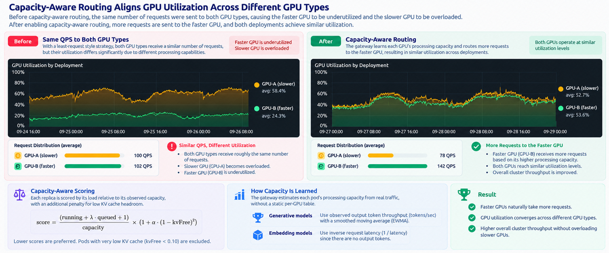
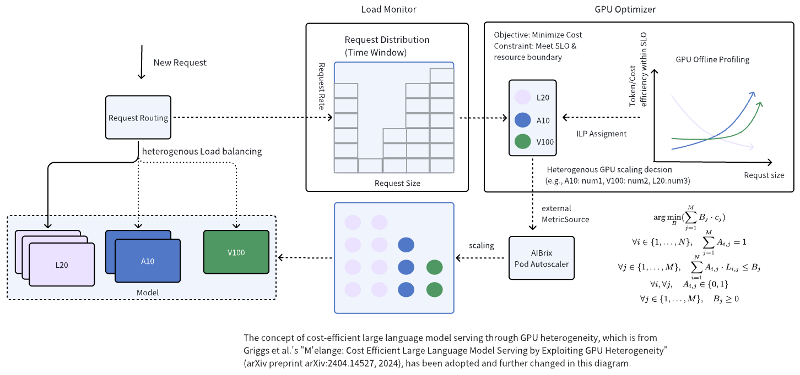
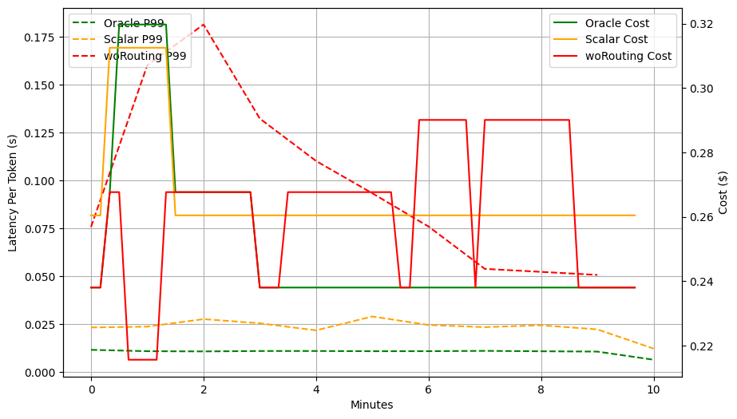
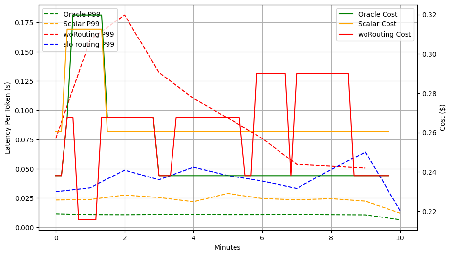
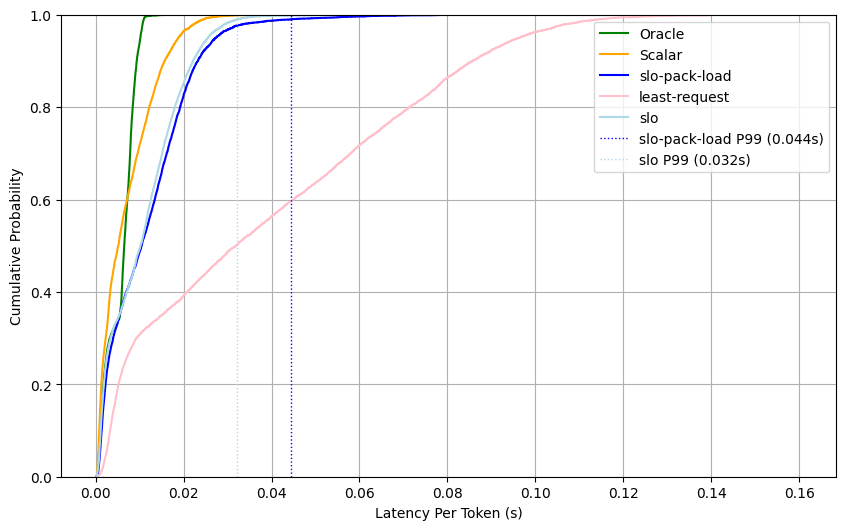

.. _heterogeneous-gpu:

==========================================
Heterogeneous GPU Inference
==========================================

Heterogeneous GPU Inference is a feature that enables users to utilize different types of GPUs for deploying the same model. This feature addresses two primary challenges associated with Large Language Model (LLM) inference: (1) As the demand for large-scale model inference increases, ensuring consistent GPU availability has become a challenge, particularly within regions where identical GPU types are often unavailable due to capacity constraints. (2) Users may seek to incorporate lower-cost, lower-performance GPUs to reduce overall expenses.

This page has two parts. `Load-Balance Routing Across GPU Types`_ describes the capacity-aware routing algorithm that spreads requests across replicas of different speeds. `GPU Optimizer and SLO Routing (experimental)`_ describes the optimizer-driven deployment workflow and the SLO-aware routing policy that the heterogeneous feature provides today.

Load-Balance Routing Across GPU Types
=====================================

Production GPU fleets are rarely homogeneous. When capacity on one GPU type is exhausted, workloads may need to spill over to hardware with very different performance characteristics. This breaks a basic assumption of traditional load balancing: equal request counts do not mean equal load. Sending the same QPS to a faster and a slower GPU can overload one deployment while leaving capacity unused on the other.

The ``load-balance`` routing strategy addresses this by scoring each replica on its current load relative to its observed capacity and routing the request to the replica with the lowest score. It needs no hardware labels and no static table of GPU performance: a mixed pool teaches the gateway its relative speeds from production traffic, and faster replicas receive proportionally more requests.

Scoring
-------

.. math::

   \text{score} =
   \frac{\text{running} + \lambda \cdot \text{queued}}{\text{capacity}}
   \times
   \left( 1 + \alpha \, (1 - \text{kvFree})^2 \right)

A lower score is a better routing candidate. The first term normalizes the work already committed to a replica by how quickly that replica can process it. The second term increasingly penalizes a replica as its free KV-cache fraction shrinks. Capacity and load are deliberately kept apart: a saturated GPU shows high token throughput *because* it is busy, so throughput only sets the denominator and is never used as a measure of load.

.. list-table::
   :header-rows: 1
   :widths: 22 48 30

   * - Term
     - Meaning
     - Source
   * - ``capacity``
     - How fast the replica drains work, in output tokens per second.
     - Gateway-observed output-token rate, smoothed with an EWMA.
   * - ``running``
     - Requests currently in flight on the replica, counted across all gateway replicas.
     - Gateway request tracking.
   * - ``queued``
     - Requests waiting in the engine queue.
     - Engine metric ``num_requests_waiting``. Only read when ``λ > 0``.
   * - ``kvFree``
     - Free fraction of the replica's KV cache.
     - Engine metric ``kv_cache_usage_perc``.

.. list-table::
   :header-rows: 1
   :widths: 18 42 12 28

   * - Symbol
     - Meaning
     - Default
     - Environment variable
   * - ``λ``
     - Weight of engine-queued requests. ``0`` because the running count already includes requests queued inside the engine; raising it counts them twice.
     - ``0``
     - ``AIBRIX_LOAD_BALANCE_QUEUED_WEIGHT``
   * - ``α``
     - Strength of the KV-pressure penalty.
     - ``2.0``
     - ``AIBRIX_LOAD_BALANCE_KV_PRESSURE_ALPHA``
   * - ``kvCritical``
     - Free-KV fraction below which a replica scores ``+Inf`` and is passed over.
     - ``0.10``
     - ``AIBRIX_LOAD_BALANCE_KV_CRITICAL_FREE``

The three values can also be set per model through a model config profile (``routingConfig.loadBalance.*``). See :doc:`../gateway-routing/gateway-plugins`.

**Worked example.** In a mixed pool, the fastest replica wins even though it carries the most requests, because it drains them fastest:

.. list-table::
   :header-rows: 1

   * - Replica
     - Running
     - Tokens/s
     - KV free
     - Calculation
     - Score
   * - A100
     - 20
     - 4000
     - 30%
     - 20/4000 × (1 + 2 × 0.70²)
     - 0.0099
   * - L20
     - 25
     - 3000
     - 60%
     - 25/3000 × (1 + 2 × 0.40²)
     - 0.0110
   * - B100
     - 30
     - 6000
     - 50%
     - 30/6000 × (1 + 2 × 0.50²)
     - **0.0075**

How Capacity Is Learned
-----------------------

Rather than relying on a static table of GPU performance, the gateway learns each replica's capacity from the traffic it serves:

* The gateway counts the output tokens each replica completes. Because the counter is kept by the gateway, it works for every engine (vLLM, SGLang, TRT-LLM, xLLM) without depending on engine-specific metric names.
* On every metrics refresh (default 1 second), the counter is converted to tokens per second over a window of about one minute and smoothed with an exponentially weighted moving average (time constant 10 seconds).
* A window with no completed tokens carries no information about speed, because the replica was idle rather than slow. The previous estimate is kept instead of decaying toward zero, so a briefly idle replica is not starved of the traffic that would re-measure it.
* A new replica with no estimate yet is scored at the mean estimate of the replicas that have one, so it competes as an average replica until enough measurements arrive. If no replica has an estimate, all replicas get the same capacity and the score reduces to load multiplied by the KV penalty.

The learned value is the *observed serving capacity under the current workload mix*, not a fixed property of the GPU. Request shape can materially change throughput even on identical hardware, particularly for input-heavy and multimodal workloads, and the estimate moves with the mix. Because it follows a window of about one minute, a sudden change shows up within tens of seconds rather than immediately.

Production Results
------------------

The figure and table below show two GPU types serving the same model, before and after capacity-aware routing was rolled out. Before, a least-request style strategy sent roughly the same QPS to both deployments, so the slower GPU was overloaded while the faster GPU was underutilized. After, the gateway sent more traffic to the faster GPU and utilization converged.

.. list-table::
   :header-rows: 1
   :widths: 40 30 30

   * -
     - Before
     - After
   * - GPU-A (slower), average utilization
     - 58.4%
     - 52.7%
   * - GPU-B (faster), average utilization
     - 24.3%
     - 53.6%
   * - GPU-A (slower), average QPS
     - 100
     - 78
   * - GPU-B (faster), average QPS
     - 102
     - 142

Balanced load does not mean equal request counts. In a heterogeneous fleet, routing should distribute work according to the capacity available to process it rather than dividing traffic evenly. Faster GPUs naturally take more requests, utilization converges across GPU types, and overall cluster throughput improves without overloading the slower GPUs.

Using Load-Balance Routing
--------------------------

Replicas of one model, such as one ``Deployment`` per GPU type that share the same ``model.aibrix.ai/name`` label, are scored together. Select the strategy explicitly with the ``routing-strategy`` request header:

.. code-block:: bash

    curl -v http://localhost:8888/v1/chat/completions \
        -H "model: llama2-7b" \
        -H "Content-Type: application/json" \
        -H "Authorization: Bearer [api_key]" \
        -H "routing-strategy: load-balance" \
        -d '{
            "model": "llama2-7b",
            "messages": [{"role": "user", "content": "Say this is a test!"}],
            "temperature": 0.7
        }'

``load-balance`` is also blended in behind other strategies by default, so its scoring influences most requests even when it is not selected explicitly. See *Auto-blended capacity awareness* in :doc:`../gateway-routing/gateway-plugins` and ``AIBRIX_ROUTING_AUTO_BLEND_LOAD_BALANCE_WEIGHT``.

Behavior in Edge Cases
----------------------

.. list-table::
   :header-rows: 1
   :widths: 35 65

   * - Situation
     - Behavior
   * - Replica has no capacity estimate yet
     - Scored at the mean estimate of the replicas that have one.
   * - Engine reports no KV usage, or ``NaN``
     - Treated as fully free: no penalty and no guardrail, so engines that lack the metric are not penalized.
   * - ``kvFree < kvCritical``
     - Score is ``+Inf``. When ``load-balance`` routes alone, the replica is skipped until it recovers. When ``load-balance`` is blended with other strategies, ``+Inf`` is only a strong penalty: another strategy that scores the replica highly can still select it.
   * - Every replica is below ``kvCritical``
     - The request does not fail. It is routed to the replica with the most KV headroom.
   * - Replica is idle (``running = 0``)
     - Score is ``0`` regardless of capacity, so idle replicas are preferred.
   * - Several replicas share the lowest score
     - Ties are broken by least combined GPU and CPU KV-cache usage, then at random.

Known Limitations
-----------------

* **Load-imbalance gate ignores capacity.** The gateway applies a load-imbalance gate ahead of whichever strategy routes the request. It compares raw running-request counts, so a faster replica that legitimately carries more concurrent requests can be flagged as a hotspot and excluded before the capacity-aware score is computed.
* **Single output-token rate.** Capacity is not split into prefill and decode throughput, so hardware whose relative performance differs between prompt-heavy and decode-heavy workloads is not modeled. Requests that report no output tokens add nothing to the estimate, so a pool that serves only such requests has no capacity signal and replicas are scored on load and KV pressure alone.
* **Multiple gateway replicas.** The token counter is local to each gateway while the running count is the cross-gateway total, so each gateway measures roughly ``1/N`` of a replica's output. Relative ranking is preserved when the gateways spread traffic similarly, but absolute score values are not comparable across deployments with different gateway counts.
* **Not used on purpose.** GPU utilization and SM-active are useful for observability but make a generic scheduler unstable, so the score uses only drain rate, committed work, and KV pressure.

GPU Optimizer and SLO Routing (experimental)
==============================================

The sections below describe what the heterogeneous GPU feature provides today beyond load-balance routing: the GPU optimizer, which decides how many replicas of each GPU type to run, and the SLO-aware routing policy.

Design Overview
---------------

There are three main components in Heterogeneous GPU Inference Feature: (1) LLM Request Monitoring, (2) Heterogeneous GPU Optimizer, (3) Request Routing. The following figure shows the overall architecture. First, LLM Request Monitoring component is responsible for monitoring the past inference requests and their request patterns. Second, Heterogeneous GPU Optimizer component is responsible for selecting the optimal GPU type and the corresponding GPU count. Third, Request Routing component is responsible for routing the request to the optimal GPU.

This feature is the heterogeneous form of :doc:`../scaling-performance/autoscaling/optimizer-based-autoscaling`:
the same GPU optimizer, fed one benchmark profile per GPU type, decides how many replicas of
each type to run. Read that page first for the request-tracing and profiling workflow; this
page covers what is specific to mixing GPU types.

Prerequisites
-------------

* One ``Deployment`` per GPU type, all carrying the same ``model.aibrix.ai/name`` label and
  each pinned to its GPU type through node selectors or affinity. The gateway treats them as
  one model.
* One ``PodAutoscaler`` per deployment, each reading the optimizer's metric for its own
  deployment.
* Request tracing enabled on the gateway plugin and the ``aibrix`` Python package installed
  locally for benchmarking, as described in :doc:`../scaling-performance/autoscaling/optimizer-based-autoscaling`.
* For SLO-aware routing across the GPU types, profiling data for each workload on each GPU
  type (see `Routing Support`_).

Example
-------

**Preparation: Enable related components, including request tracking at the gateway.**

.. code-block:: bash

    # Replace the gateway plugin with the experimental overlay. That overlay sets
    # AIBRIX_GPU_OPTIMIZER_TRACING_FLAG=true and uses the nightly gateway image.
    kubectl delete -k config/experimentals/gpu-optimizer
    kubectl apply -k config/experimentals/gpu-optimizer

Alternatively, add the variable to the existing gateway plugin deployment with ``kubectl edit deployment aibrix-gateway-plugins -n aibrix-system``:

.. code-block:: yaml

    env:
    - name: AIBRIX_GPU_OPTIMIZER_TRACING_FLAG
      value: "true"

**Step 1: Deploy the heterogeneous deployments.**

One deployment and corresponding PodAutoscaler should be deployed for each GPU type.
See `sample heterogeneous configuration <https://github.com/vllm-project/aibrix/tree/main/samples/heterogeneous>`_ for an example of heterogeneous configuration composed of two GPU types. The following command
deploys heterogeneous deployments using L20 and V100 GPUs.

.. code-block:: bash

    kubectl apply -k samples/heterogeneous

The sample is a kustomization that creates one Service and two deployments,
``deepseek-coder-7b-l20`` (4 replicas) and ``deepseek-coder-7b-v100`` (0 replicas), each pinned
to its GPU type through node affinity on the ``machine.cluster.vke.volcengine.com/gpu-name``
label. Adjust the affinity and replica counts to your cluster. The output below comes from a
test environment with one pod per GPU type:

.. code-block:: bash

    kubectl get svc
    NAME                TYPE        CLUSTER-IP      EXTERNAL-IP   PORT(S)          AGE
    deepseek-coder-7b   NodePort    10.102.95.136   <none>        8000:30081/TCP   2s
    kubernetes          ClusterIP   10.96.0.1       <none>        443/TCP          54d

Incoming requests are routed through the gateway and directed to the optimal pod based on request patterns:

.. code-block:: bash

    kubectl get pods
    NAME                                       READY   STATUS    RESTARTS   AGE
    deepseek-coder-7b-v100-96667667c-6gjql     2/2     Running   0          33s
    deepseek-coder-7b-l20-96667667c-7zj7k      2/2     Running   0          33s

**Step 2: Install aibrix python module.**

.. code-block:: bash

    pip3 install aibrix

The GPU Optimizer runs continuously in the background, dynamically adjusting GPU allocation for each model based on workload patterns. Note that GPU optimizer requires offline inference performance benchmark data for each type of GPU on each specific LLM model.

  
The profiles checked in under `python/aibrix/aibrix/gpu_optimizer/optimizer/profiling/result/ <https://github.com/vllm-project/aibrix/tree/main/python/aibrix/aibrix/gpu_optimizer/optimizer/profiling/result/>`_ are simulator results for ``llama2-7b`` on A100 and A40. They do not match the deepseek-coder L20 and V100 sample, so run Step 3 for that sample. Use the checked-in files only when you deploy ``llama2-7b`` on those two GPUs.

**Step 3: Benchmark model.**

For each type of GPU, run ``aibrix_benchmark``. See `benchmark.sh <https://github.com/vllm-project/aibrix/tree/main/python/aibrix/aibrix/gpu_optimizer/optimizer/profiling/benchmark.sh>`_ for more options.

.. code-block:: bash

    kubectl port-forward [pod_name] 8010:8000 1>/dev/null 2>&1 &
    # Wait for port-forward taking effect.
    aibrix_benchmark -m deepseek-coder-7b -o [path_to_benchmark_output]

**Step 4: Decide SLO and generate profile.**

Run ``aibrix_gen_profile -h`` for help.
  
.. code-block:: bash

    kubectl -n aibrix-system port-forward svc/aibrix-redis-master 6379:6379 1>/dev/null 2>&1 &
    # Wait for port-forward taking effect.
    aibrix_gen_profile deepseek-coder-7b-v100 --cost [cost1] [SLO-metric] [SLO-value] -o "redis://localhost:6379/?model=deepseek-coder-7b"
    aibrix_gen_profile deepseek-coder-7b-l20 --cost [cost2] [SLO-metric] [SLO-value] -o "redis://localhost:6379/?model=deepseek-coder-7b"

Now the GPU Optimizer is ready to work. You should observe that the number of workload pods changes in response to the requests sent to the gateway. Once the GPU optimizer finishes the scaling optimization, the output of the GPU optimizer is passed to PodAutoscaler as a metricSource via a designated HTTP endpoint for the final scaling decision.  The following is an example of PodAutoscaler spec.

A simple example of PodAutoscaler spec for v100 GPU is as follows:

.. literalinclude:: ../../../../samples/heterogeneous/deepseek-coder-7b-v100-podautoscaler.yaml
   :language: yaml

Miscellaneous
-------------

The ``model.aibrix.ai/min_replicas`` label sets how many replicas of that GPU type to keep when there is no workload. Set it to ``"1"`` on at least one Deployment so the model always has a ready pod. For example, the optimizer may recommend 0 replicas for a V100 while the model is idle, and ``model.aibrix.ai/min_replicas: "1"`` keeps one V100 replica. The label applies only when there is no workload. Active requests ignore it.

.. code-block:: yaml

    apiVersion: apps/v1
    kind: Deployment
    metadata:
      name: deepseek-coder-7b-v100
      labels:
        model.aibrix.ai/name: "deepseek-coder-7b"
        model.aibrix.ai/min_replicas: "1" # min replica for gpu optimizer when no workloads.
    ... rest yaml deployments

Important: The ``minReplicas`` field in the PodAutoscaler spec must be set to 0 to allow proper scaling behavior. Setting it to any value greater than 0 will interfere with the GPU optimizer's scaling decisions. For instance, if the GPU optimizer determines an optimal configuration of ``{v100: 0, l20: 4}`` but the v100 PodAutoscaler has ``minReplicas: 1``, the system won't be able to scale the v100 down to 0 as recommended.

Configuration reference
-----------------------

.. list-table::
   :header-rows: 1
   :widths: 40 60

   * - Setting
     - Meaning
   * - ``AIBRIX_GPU_OPTIMIZER_TRACING_FLAG`` (gateway plugin env, default ``false``)
     - Records per-request token statistics for the optimizer. Required.
   * - ``model.aibrix.ai/name`` (label on every deployment)
     - The shared model name. Must match the ``model`` used when profiles were stored.
   * - ``model.aibrix.ai/min_replicas`` (label on a deployment)
     - Replicas to keep for that GPU type when there is no traffic. Set it to ``"1"`` on at
       least one deployment so the model always has a ready pod.
   * - ``spec.minReplicas: 0`` (on each PodAutoscaler)
     - Required. Any higher value prevents the optimizer from scaling that GPU type to zero.
   * - ``aibrix_gen_profile ... --cost <n>``
     - Relative cost of the GPU type. The optimizer minimizes total cost, so give each GPU
       type its own value.
   * - ``routing-strategy: slo`` (request header)
     - Turn on SLO-aware routing for the request. Variants: ``slo-pack-load``,
       ``slo-least-load``, ``slo-least-load-pulling`` (the default for ``slo``).

Routing Support
---------------

During the performance evaluation, we observed that the existing routing policy does not adequately account for the varying serving capacities of heterogeneous GPUs. Specifically, the subsequent plot illustrates that the current routing strategy fails to adhere to the specified Service Level Objective (SLO). This evaluation predates the capacity-aware ``load-balance`` strategy described above.

The experimental configuration is as follows:

- SLO: P99 latency per token ≤ 0.05 seconds.
- Workloads: A mixed workload comprising `ShareGPT <https://huggingface.co/datasets/anon8231489123/ShareGPT_Vicuna_unfiltered>`_ (7 RPS) and CodeGeneration tasks (4 RPS), characterized by long prompts (over 4K tokens) and short responses (32-64 tokens).
- GPUs: A heterogeneous GPU environment consisting of NVIDIA A10 and NVIDIA L20 GPUs.

Our experiments indicate that an ideal routing scenario (Oracle) would assign ShareGPT workloads exclusively to A10 GPUs and CodeGeneration workloads exclusively to L20 GPUs. However, the existing routing policy (woRouting) randomly distributes requests between A10 and L20 GPUs, failing to replicate this ideal scenario. For comparative purposes, we also evaluated a scenario where all requests are handled solely by the more capable L20 GPUs (Scalar). Results demonstrated that although GPU optimizers can identify an optimal GPU configuration (Oracle Cost), the current routing policy results in significant performance degradation, queue accumulation at the gateway, unstable GPU configurations, and consistent violations of the SLO.

SLO routing policy was introduced in version v0.4.0 to address performance issues in heterogeneous GPU deployments. Requests must explicitly specify the ``routing-strategy: slo`` header to enable the SLO routing policy. Additionally, profiling data for each workload on each GPU is required to activate this policy effectively.

An example request applying the SLO routing policy is shown below:

.. code-block:: bash

    curl -v http://localhost:8888/v1/chat/completions \
		-H "model: llama2-7b" \
		-H "Content-Type: application/json" \
		-H "Authorization: Bearer [api_key]" \
		-H "routing-strategy: slo" \
		-d '{ \
			"model": "llama2-7b", \
			"messages": [{"role": "user", "content": "Say this is a test!"}], \
			"temperature": 0.7 \
		}'

In the same experimental settings, the SLO routing policy demonstrated its capability to achieve the targeted performance objectives.

The SLO routing policy currently supports three variations: ``slo-pack-load``, ``slo-least-load``, and ``slo-least-load-pulling``(default policy when ``slo`` is specified). Each variation routes requests to GPUs likely to meet their respective SLOs but differ in handling requests among GPUs of the same type:

- ``slo-pack-load``: Prefers consolidating requests onto a single GPU if profiling suggests no SLO violation.
- ``slo-least-load``: Prefers routing requests to the least-loaded GPU of the same type, ignoring SLO violation predictions from profiling.
- ``slo-least-load-pulling``: Prefers routing requests to the least-loaded GPU of the same type. Requests predicted to violate the SLO are queued at the gateway and rejected if the SLO has already been breached.

The following figure compares the performance of the ``slo/slo-least-load-pulling`` and ``slo-pack-load`` variations. ``least-request`` policy is used as the baseline for a fair comparison.

