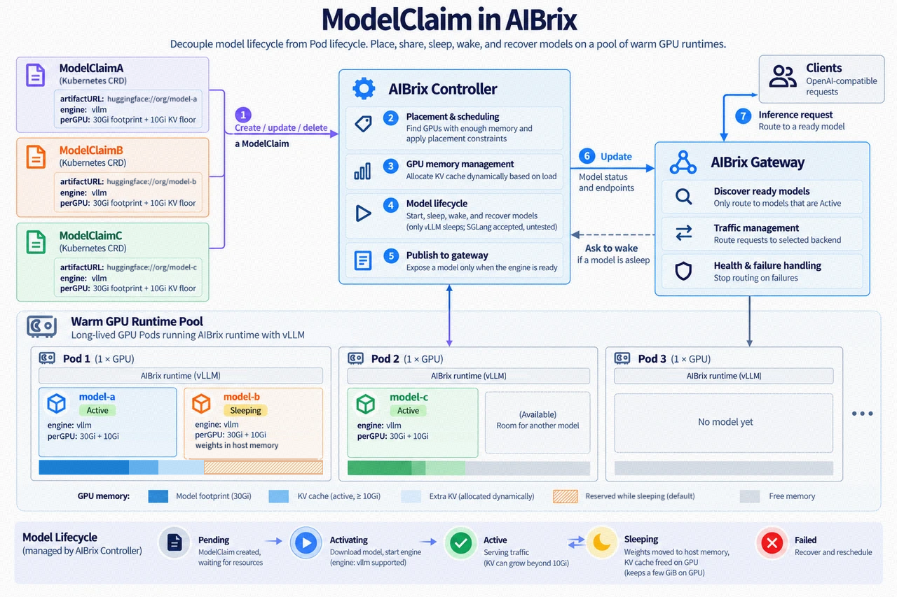

.. _modelclaim:

===========
Model Claim
===========

.. warning::

   ModelClaim is experimental. Read `Limitations`_ before you rely on it.

ModelClaim serves several models from the same GPUs. You deploy a warm pool,
which is a Deployment of GPU Pods that run the AIBrix runtime agent, and create
one ModelClaim for each model. The controller starts each model as its own
engine process, on a Pod whose GPU has room for it. The AIBrix gateway then
routes requests to that engine by model name. A pool can also put idle models
to sleep, which frees GPU memory for the models in use, and the next request
for a sleeping model wakes it.

ModelClaim suits models that are busy only part of the time and would
otherwise each need a GPU of their own.

How it works
------------

.. mermaid::

   flowchart LR
     subgraph P["Warm pool Pod"]
       R["Runtime agent"] --> E1["Engine for model A"]
       R --> E2["Engine for model B"]
     end
     U["Client"] --> G["AIBrix gateway"]
     G -->|"requests for model A"| E1
     M["ModelClaims"] --> C["ModelClaim controller"]
     C -->|"start, sleep, wake, KV limits"| R
     C -.->|"routes, as Pod annotations"| G

* A **warm pool** is a Deployment whose Pods run the ModelClaim runtime image
  and request a fixed number of GPUs. In each Pod, the runtime agent starts,
  stops, sleeps and wakes engine processes for the controller.
* A **ModelClaim** names a model and the pool it runs in. It also sets the
  engine arguments, and declares how much GPU memory one instance needs.
* The **ModelClaim controller** places each claim on a Pod whose GPU has room
  for it, and has the runtime agent start the engine there. The engines on a
  GPU share its memory for their KV caches through kvcached, and the
  controller gives each engine a KV cache limit. Once an engine is ready, the
  controller writes its port in an annotation on the Pod, which this guide
  calls the engine's route.
* The **AIBrix gateway** reads the routes and sends each request to the engine
  of its model. When the model is asleep, the gateway asks the controller to
  wake it and tells the client to retry.

Limitations
-----------

* **One engine per claim.** ``replicas`` must be 1, so a claim runs one engine
  on one Pod.
* **Tested setups.** ModelClaim has been tested with vLLM on NVIDIA H20 GPUs,
  with tensor parallelism 1 and 2 in one Pod. Pipeline parallelism, tensor
  parallelism above 2, Pods with more than two GPUs and other GPU types have
  not been tested. Data parallelism is not supported.
* **One GPU layout per pool.** A vLLM claim must use all the GPUs of its Pod,
  so models with different parallelism go in separate pools.
* **Host memory is not managed.** ModelClaim puts engines to sleep with vLLM's
  sleep level 1, which moves a model's weights from the GPU to host memory
  until the engine wakes. The controller does not count host memory when it
  places claims or puts engines to sleep. If many models sleep on one node,
  the node can run out of memory, and engines can be killed. Size the pool's
  memory request for all its models asleep at once.
* **Sleep and wake are per pool, and on request.** Only vLLM engines sleep.
  The sleep policy applies to every model in a pool, so a model that must stay
  awake needs a pool without idle sleep. A sleeping model wakes only when a
  request for it reaches the AIBrix gateway, which answers that request with
  503 instead of holding it, so clients must retry.
* **Declared GPU memory.** The controller trusts the figures that a claim
  declares in ``perGPU``, and does not measure a model's footprint. kvcached
  limits only the KV cache, so an engine that needs more than its declared
  footprint can run the GPU out of memory.
* **No live migration.** A claim moves to another Pod when its engine fails
  permanently or cannot wake where it is. A new engine then loads the model
  there, and the model serves nothing until that engine is ready.
* **No hard preemption.** ``SleepLowerPriority`` is reversible and keeps the
  victim's instance binding. ``StopLowerPriority`` is not supported; durable
  drain, stop, restart recovery and victim re-entry are tracked separately in
  `issue #3154 <https://github.com/vllm-project/aibrix/issues/3154>`_.
* **Runtime image.** The published runtime image contains vLLM and is built
  for ``linux/amd64`` only. It is published from ``main`` and is not part of
  AIBrix releases. ``engine: sglang`` needs your own image with SGLang and
  kvcached, and has not been tested.
* **Model sources.** Only Hugging Face artifacts (``huggingface://``) have been
  tested.
* **Claim names.** A claim's name can be at most 63 characters, because it is
  part of annotation keys on the Pod.
* **No access control.** The runtime agent's API on port 8080 has no
  authentication, and the engines accept vLLM's own sleep and wake calls on
  their ports, from 20000 to 20999. Anything that can reach a pool Pod can
  start, stop, sleep or wake its engines. Limit access to these ports, for
  example with a NetworkPolicy that admits only the ModelClaim controller,
  Envoy and Prometheus.

Before you begin
----------------

* A Kubernetes cluster with NVIDIA GPU nodes on ``linux/amd64`` and the NVIDIA
  device plugin.
* The AIBrix control plane. Its standard installation includes ModelClaim's
  CRD and controller, and the gateway's support for it. See
  :doc:`../../getting_started/installation/installation`.
* Access from the GPU nodes to Docker Hub for the runtime image, and to
  wherever your models are stored.

Check that the control plane is ready:

.. code-block:: bash

   kubectl get crd modelclaims.model.aibrix.ai
   kubectl -n aibrix-system rollout status deployment/aibrix-controller-manager --timeout=10m
   kubectl -n aibrix-system rollout status deployment/aibrix-gateway-plugins --timeout=10m

Quick start
-----------

The samples run two small Qwen models on one GPU, in the ``default``
namespace. Each claim declares a 6 GiB footprint and a 1 GiB KV floor, so the
GPU needs at least 14 GiB, and the Pod requests 16 GiB of host memory. Run the
commands from the repository root.

Create the warm pool and wait for its Pod:

.. code-block:: bash

   kubectl apply -f samples/modelclaim/warm-runtime-pool.yaml
   kubectl -n default rollout status deployment/warm-runtime-pool --timeout=15m

Create the two claims and watch them start:

.. code-block:: bash

   kubectl apply -f samples/modelclaim/modelclaims.yaml
   kubectl -n default get modelclaims -w

Each claim reads ``Activating`` once it is placed, and ``Active`` once its
engine serves. The first start downloads the model, so it can take a few
minutes:

.. code-block:: text

   NAME          PHASE    DESIRED   READY   ENGINE   ARTIFACT                                   AGE
   qwen25-0-5b   Active   1         1       vllm     huggingface://Qwen/Qwen2.5-0.5B-Instruct   3m
   qwen3-0-6b    Active   1         1       vllm     huggingface://Qwen/Qwen3-0.6B              3m

To send requests through the gateway, keep a port-forward to Envoy running in
another terminal:

.. code-block:: bash

   ENVOY=$(kubectl -n envoy-gateway-system get service \
     --selector=gateway.envoyproxy.io/owning-gateway-namespace=aibrix-system,gateway.envoyproxy.io/owning-gateway-name=aibrix-eg \
     -o jsonpath='{.items[0].metadata.name}')
   kubectl -n envoy-gateway-system port-forward "service/$ENVOY" 8888:80

Then send a request with a claim's ``modelName`` as the model. The
``routing-strategy`` header is needed, as `Requests`_ explains:

.. code-block:: bash

   curl -s localhost:8888/v1/chat/completions \
     -H 'Content-Type: application/json' -H 'routing-strategy: random' \
     -d '{"model": "qwen3-0.6b", "messages": [{"role": "user", "content": "Say hello."}], "max_tokens": 32}'

Let idle models sleep by giving the pool a sleep policy:

.. code-block:: bash

   kubectl -n default annotate deployment/warm-runtime-pool --overwrite \
     'claim.model.aibrix.ai/pool-policy={"lifecycle":{"sleepAfterSeconds":60}}'

Once a model has had no requests for 60 seconds, the controller puts it to
sleep, and its claim shows ``Sleeping``. The next request for it gets ``503``
with ``Retry-After: 3``, and the gateway requests a wake. Retry after three
seconds; the model may still be waking.

To clean up, delete the claims first, so that the controller stops their
engines:

.. code-block:: bash

   kubectl delete -f samples/modelclaim/modelclaims.yaml
   kubectl delete -f samples/modelclaim/warm-runtime-pool.yaml

Warm pools
----------

A warm pool is a Deployment. The sample runs one Pod with one GPU:

.. literalinclude:: ../../../../samples/modelclaim/warm-runtime-pool.yaml
   :language: yaml

What its fields do:

``claim.model.aibrix.ai/pool`` and ``claim.model.aibrix.ai/enabled`` labels
   Claims select a pool by its ``pool`` label. The controller places claims
   only on Pods that also have ``enabled: "true"``. A claim already on a Pod
   stays there when the Pod loses either label, until the Pod stops running
   or is deleted.

``nvidia.com/gpu``
   The number of GPUs in each Pod. A vLLM claim runs only on Pods whose GPU
   count equals its tensor parallel size times its pipeline parallel size. For
   a model that needs two GPUs, create another pool whose Pods request two, and
   give the claim ``--tensor-parallel-size: "2"``.

``image``
   ``aibrix/kvcached-runtime`` contains the runtime agent, vLLM and kvcached,
   on top of ``ghcr.io/ovg-project/kvcached-vllm:kvcached-v0.1.6-vllm-v0.30.0``.
   CI publishes it on every push to ``main``, tagged ``nightly`` and with the
   commit's full SHA. With a control plane built from ``main``, use the image
   of the same commit, pinned by its SHA tag. With ``nightly`` and the
   sample's ``IfNotPresent``, a node keeps the first ``nightly`` it pulled.
   AIBrix releases do not publish this image. For a release, or for another
   base image, build the image yourself from a checkout of the commit your
   control plane runs:

   .. code-block:: bash

      export AIBRIX_CONTAINER_REGISTRY_NAMESPACE=<your registry>/aibrix
      export KVCACHED_RUNTIME_BASE_IMAGE=<base image with vLLM and kvcached>
      export IMAGE_TAG="$(git rev-parse HEAD)"
      IS_MAIN_BRANCH=false make docker-build-kvcached-runtime docker-push-kvcached-runtime

``resources.requests.memory``
   Host memory for the runtime agent and its engines. A sleeping engine keeps
   its model's weights in host memory, so size this for all the Pod's models
   asleep at once.

``/dev/shm``
   A memory-backed volume that kvcached and vLLM use to share memory between
   processes. The sample allows it 16 GiB.

The ``hf-cache`` volume and ``AIBRIX_WEIGHT_CACHE_DIR``
   The volume is a directory on the node, mounted at the Hugging Face cache,
   ``/root/.cache/huggingface``, where engines download their models. A Pod
   that is recreated on that node therefore does not download them again.
   ``AIBRIX_WEIGHT_CACHE_DIR`` points the runtime agent at the same directory,
   where it notes the models it has served. The controller prefers Pods that
   have served a model before.

``/var/run/aibrix``
   The runtime agent keeps its list of engines here. When the agent restarts,
   it reads the list and takes its engines back without restarting them.

``ENABLE_KVCACHED: "false"`` and ``KVCACHED_AUTOPATCH: "0"``
   These apply to the runtime agent, which must not load kvcached itself. The
   agent turns kvcached on in each engine it starts.

Other environment variables
   Engines inherit the container's environment. Set ``HF_TOKEN`` or
   ``HF_ENDPOINT`` on the container when your models need them.

``readinessProbe``
   The Pod is Ready once the runtime agent answers on ``/healthz``. The
   gateway sends requests only to Ready Pods.

The metrics Service
   Its ``aibrix.ai/metrics: modelclaim-runtime`` label and its port named
   ``runtime`` let Prometheus find the runtime agent's metrics. See
   `Monitoring`_.

Changing the Pod template, for example its image, replaces the Pods. Their
engines stop with them, and the controller places their claims again.

ModelClaims
-----------

The sample claims:

.. literalinclude:: ../../../../samples/modelclaim/modelclaims.yaml
   :language: yaml

.. list-table::
   :header-rows: 1
   :widths: 28 72

   * - Field
     - Meaning
   * - ``modelName``
     - The name clients send as ``model``. Defaults to the claim's name. Give
       each claim its own model name.
   * - ``podSelector``
     - Required. Selects the pool, usually by ``claim.model.aibrix.ai/pool``,
       among the Pods in the claim's namespace.
   * - ``artifactURL``
     - Required. Where the model comes from, such as
       ``huggingface://Qwen/Qwen3-0.6B``.
   * - ``engine``
     - ``vllm``, the default, or ``sglang``.
   * - ``replicas``
     - Must be 1, the default.
   * - ``priority``
     - An immutable non-negative 32-bit placement priority. A higher value
       gets the next placement opportunity before a lower value when unplaced
       claims compete for a pool. It defaults to 0 when omitted.
   * - ``preemptionPolicy``
     - Immutable. ``Never`` (the default) preserves non-preemptive placement.
       ``SleepLowerPriority`` may put request-idle, strictly lower-priority
       vLLM claims to sleep when this unplaced claim needs GPU room.
   * - ``engineConfig.args``
     - Engine flags and their values, as strings. An empty string adds a flag
       without a value.
   * - ``perGPU.maximumFootprint``
     - Needed for placement. The most GPU memory one instance holds on a GPU
       apart from its KV cache. That covers weights, CUDA graphs, activations
       and memory the allocator keeps.
   * - ``perGPU.kvFloor``
     - Needed for placement. The KV cache one instance needs on a GPU to serve
       a single request of its maximum length.

Only ``perGPU`` can change after a claim is created. To change anything else,
delete the claim and create it again.

Placement priority
~~~~~~~~~~~~~~~~~~

``priority`` decides the placement order only for claims that do not yet have
an instance. It is a non-negative ``int32``: higher numbers are considered
first, and omitting the field means 0. The value is immutable, so create a new
ModelClaim to change it.

For claims of the same priority that compete for at least one Pod, the
controller provides reliable FIFO admission by creation time, then by name.
Claims that omit ``priority`` therefore compete at priority 0 with the same
deterministic FIFO admission; their order does not depend on which reconcile
event happens first. The controller uses BestEffortFIFO: a higher-priority or
earlier claim that cannot fit now and cannot make room does not block a
feasible claim behind it. Claims that select different pools do not compete.

With the default ``preemptionPolicy: Never``, priority only chooses which
unplaced claim gets the next placement opportunity and does not stop or move
an existing instance. Normal placement may still resize KV limits or sleep
eligible idle engines to make room. Once a claim has begun making room and
holds a valid reservation, it keeps that placement turn until it is placed,
releases the reservation, the reservation expires, or the claim is deleted;
a later, higher-priority claim cannot take it. Strict priority can starve a
low-priority claim when feasible higher-priority claims continue to arrive.

A zero-instance claim whose engine could not be activated remains ``Failed``
during its activation-failure backoff and does not block a later feasible
claim during that wait. When its retry is due, it re-enters admission at its
numeric priority and FIFO position; ``Failed`` does not lower its priority.

Soft preemption
~~~~~~~~~~~~~~~

Set ``preemptionPolicy: SleepLowerPriority`` on an unplaced claim to let it
make room by sleeping lower-priority engines. This replaces ordinary make-room
for that claim; it does not fall back to sleeping equal- or higher-priority
engines after their normal idle threshold. The field is immutable and defaults
to ``Never``. A claim created before this field existed behaves as ``Never``.

A victim must be in the same namespace and on a selected Pod, have a strictly
lower numeric priority, and be a vLLM engine whose claim and Runtime state are
Active, Alive and Ready. The Runtime snapshot must contain authoritative
request metrics with both running and waiting counts equal to zero. A missing
metric is never treated as idleness. Pool sleep eligibility still applies;
soft preemption requires ``noWakeReserveWhileAsleep: true`` and bypasses only
``sleepToMakeRoomAfterSeconds``.

The planner protects priority before minimizing the number of victims. It
considers lower numeric victim priorities first, then idle time and claim
name. Across Pods it compares the highest victim priority, the sum of victim
priorities, whether sleeping footprints are known, victim count, first idle
time, artifact cache and Pod name. Several priority-1 victims therefore beat
one priority-90 victim for a priority-100 preemptor.

For an unknown sleeping footprint, cross-Pod ranking includes the full
optimistic victim prefix needed to make room, even though execution stops at
the first unknown victim and replans from its measured footprint.

The controller reserves the target card for two minutes and sleeps one victim
per reconcile pass. When a victim's sleeping footprint is unknown, it sleeps
that victim alone, reads a fresh Runtime snapshot, and replans instead of
assuming all declared memory was released. The preemptor stays ``Pending``
with Scheduled reason ``MakingRoom`` until physical room is available. Any
request-triggered wake whose claim has a strictly higher priority than the
preemptor keeps its capacity reserve and is judged by ordinary wake admission.
Equal- and lower-priority wakes cannot consume the reserved room until the
reservation is released or expires. After ordinary wake admission resumes, a
waking claim that must make room can sleep only idle neighbours with equal or
lower priority; strictly higher-priority claims remain protected. Eligible
victims keep the existing longest-idle ordering, followed by claim name. Wake
requests retain their existing FIFO ordering relative to one another.

No cross-claim ownership is stored in Status. After a controller restart, an
already sleeping victim remains authoritative in Runtime and claim Status;
the preemptor measures the current card and establishes a new reservation if
more room is needed. A Sleep failure releases the reservation, leaves the
victim's authoritative state unchanged, and enters ordinary placement
backoff so another feasible waiting claim can proceed.

Successful victims receive a ``PreemptedBySleep`` Event. A failed action emits
``PreemptionFailed`` on both claims. Controller metrics count bounded outcomes
in ``aibrix_modelclaim_preemption_attempts_total{policy,result,reason}`` and
``aibrix_modelclaim_preemption_victims_total{action,result}``; object names,
namespaces, Pod names and UIDs are deliberately absent from these labels.

The runtime agent sets ``--model``, ``--served-model-name``, ``--host``,
``--port`` and ``--enable-sleep-mode`` itself, so leave them out of
``engineConfig.args``. Leave out ``--gpu-memory-utilization`` as well, since
kvcached manages the KV cache. A vLLM claim with that flag fails with
``InvalidEngineConfig``. So does one whose parallel sizes are not positive
whole numbers, or whose data parallel size is not 1.

Declare what a model needs on a GPU
~~~~~~~~~~~~~~~~~~~~~~~~~~~~~~~~~~~

The controller places a claim only on a Pod whose GPU has room for its
``maximumFootprint`` plus its ``kvFloor``. Engines already on that GPU count
with their footprints and their KV caches, and each KV cache counts as at
least its effective KV floor. With tensor or pipeline parallelism, give the
figures for the GPU that holds the most.

The controller does not measure models, so measure them yourself:

1. Create the claim with generous figures, on a GPU with room to spare.
2. Send it requests of its maximum length. While it serves them, the runtime
   snapshot (see `Status`_) shows its engine's GPU memory in
   ``hbm_peak_bytes`` and its KV cache in ``kv_used_bytes``. The footprint is
   about ``hbm_peak_bytes`` minus ``kv_used_bytes``. ``hbm_peak_bytes`` reads 0
   when the runtime agent cannot match GPU processes to the engine. Then use
   how far the GPU's ``hbm_free_bytes`` fell when the engine started.
3. Lower ``maximumFootprint`` to what you measured, with some margin. For a
   model on one GPU, ``kvFloor`` is about 2 × layers × KV heads × head size ×
   bytes per value × the maximum model length.

Declaring more than a model needs wastes room, while declaring less can run
the GPU out of memory.

A claim without ``perGPU``, or with a figure that is not positive, stays
``Pending``, and its ``Scheduled`` condition reads ``InvalidPerGPU``. A claim
that is larger than every GPU in its pool stays ``Pending`` with
``TooLargeForAnyCard``.

Placement and GPU memory
------------------------

A Pod can take a claim when it is in the claim's namespace, matches its
``podSelector``, has ``claim.model.aibrix.ai/enabled: "true"``, is running
with an IP address, and has as many GPUs as the claim needs. The controller
places the claim on such a Pod whose GPU has room for it. Among those, it
prefers a Pod that has served the model before, since the weights are already
on the node. After that, it prefers the Pod with the fewest models awake, then
the one with the most room.

When no Pod has room, the claim stays ``Pending``. Its ``Scheduled`` condition
reads ``NoMatchingPods``, and its message names the Pod that came closest and
what it lacks. The controller tries again after 10, 20 and 40 seconds and then
every minute. It also tries at once when room may have appeared, for example
when another claim is deleted or goes to sleep.

When several unplaced claims can use the same newly available room, priority
chooses the first feasible claim as described in `Placement priority`_. A
claim that is otherwise feasible but waits for an earlier placement turn stays
``Pending`` with ``Scheduled`` reason ``WaitingForPlacementTurn``. This wait
does not add placement-refusal backoff.

The controller divides each GPU among the engines on it. Each engine keeps its
declared footprint and at least its effective KV floor. The rest of the GPU's
usable memory goes to the KV caches of the engines that are awake, and the busy ones
get more. A GPU's usable memory is its total memory less what the driver
reserves. kvcached
keeps each engine within its KV limit, which the claim records in
``status.instances[].kvLimitBytes``. The limits change when engines start,
stop, sleep or wake, and when the load moves between them.

An engine sizes its KV block pool once, when it starts, and must never be given
a KV limit above that size. The runtime agent reports the size as
``kv_initial_capacity_bytes`` in its snapshot, and the controller and runtime cap
the engine's KV limit at it. Room above the cap stays unassigned. When the size is
not known, the field is ``null``. The runtime defers limit writes while startup
capacity can still be captured. Writes above a saved but temporarily unverifiable
ceiling are deferred for up to five seconds; if verification times out, the
previous uncapped fallback applies. When capture is unavailable and no saved
ceiling awaits verification, limits remain uncapped.

The effective KV floor is the declared ``kvFloor``, reduced to the startup
capacity when that capacity is known, positive and smaller. The controller
reports this reduction with a ``KVCapacityBelowFloor`` Warning on the claim.

An engine goes on the route only once it is ready and runs within its KV
limit. If something else raises an engine's KV limit, the controller sets it
back, and keeps the engine off the route until then.

Sleep and wake
--------------

A pool's sleep policy is a JSON annotation on its Deployment,
``claim.model.aibrix.ai/pool-policy``, and it applies to every model in the
pool:

.. code-block:: bash

   kubectl -n default annotate deployment/warm-runtime-pool --overwrite \
     'claim.model.aibrix.ai/pool-policy={"lifecycle":{"sleepAfterSeconds":300,"noWakeReserveWhileAsleep":true}}'

.. list-table::
   :header-rows: 1
   :widths: 36 64

   * - Field
     - Meaning
   * - ``lifecycle.sleepAfterSeconds``
     - How long a model must be idle before the controller puts it to sleep. A
       model is idle while it has no request running or waiting. Leave the
       field out, or set it to 0, to keep models awake unless room is needed.
       That is allowed only with ``noWakeReserveWhileAsleep``.
   * - ``lifecycle.noWakeReserveWhileAsleep``
     - ``false`` by default, so a sleeping model keeps its room on the GPU.
       When ``true``, a sleeping model reserves only the GPU memory it still
       holds, and other models can use the rest.
   * - ``lifecycle.sleepToMakeRoomAfterSeconds``
     - Used only with ``noWakeReserveWhileAsleep``. How long a model must be
       idle before the controller may put it to sleep to make room for
       another model. It defaults to 30 seconds, or to ``sleepAfterSeconds`` if
       that is shorter. It must be positive, and no longer than
       ``sleepAfterSeconds`` when that is set.

A policy with an unknown field or an invalid value is turned off, and the
Deployment gets an ``InvalidPoolPolicy`` Event. The policy also accepts a
deprecated ``reclaim`` section, which has no effect on claims that declare
``perGPU``.

The controller puts a model to sleep once it has been idle for
``sleepAfterSeconds``. It first takes the model off the route and checks again
that no request is in progress. If one is, the model stays awake. Otherwise,
the engine sleeps with vLLM's sleep level 1, which moves its weights to host
memory and frees its KV cache for the models that are awake. The claim shows
``Sleeping``.

When a request for a sleeping model reaches the gateway, the gateway answers
503 and writes a wake request on the Pod, unless one is there already. The
controller then wakes the engine, and puts it back on the route once it is
ready. Many requests for one sleeping model cause a single wake. The controller
removes the wake request once the model serves, when the wake fails, or after
five minutes.

By default, a sleeping model keeps its room on the GPU, so that it can wake
where it is. Only its KV cache above its effective KV floor goes to the other
models on the GPU, and they give it back when it wakes.

With ``noWakeReserveWhileAsleep``, a sleeping model reserves only what it still
holds on the GPU, which the runtime agent measures after each sleep. The rest
can go to other models, so a pool can hold more models than fit awake at once.
A model that wakes then needs room again:

* If its GPU has room, it wakes at once.
* Otherwise, the controller puts other models on the GPU to sleep, the longest
  idle first and one at a time, until the waking model fits. It takes only
  models that have been idle for ``sleepToMakeRoomAfterSeconds`` and whose
  claims have the same or a lower priority than the waking model's claim.
  Meanwhile, the waking model's claim reads ``WaitingForRoom``, and each model
  put to sleep gets a ``SleptToMakeRoom`` Event.
* If no model can be put to sleep for it, and another Pod has room, the model
  moves there. A new engine loads it on that Pod.
* Otherwise, it waits for room for up to five minutes, and the next request
  asks again.

In such a pool, a new claim that no Pod has room for gets room the same way.
With the default ``preemptionPolicy: Never``, making room this way does not
compare priorities, so an idle model of any priority may be put to sleep for
the claim.
The controller puts idle models to sleep on one Pod, and the claim's
``Scheduled`` condition reads ``MakingRoom`` until the claim is placed.
``SleepLowerPriority`` uses the same pool safety rules and reservation, but
may sleep a strictly lower-priority request-idle engine before the ordinary
``sleepToMakeRoomAfterSeconds`` duration has elapsed.

If the runtime agent cannot measure what a sleeping engine holds, the engine
keeps its full room, and its claim gets a ``SleepingFootprintUnknown`` Event.
While ``noWakeReserveWhileAsleep`` is on, do not wake engines through the
runtime agent's API, because such a wake skips the controller's check for
room.

Failures
--------

Each engine is a separate process, so a crash stops only that engine. The
runtime agent restarts it on the same port after 2, 4, 8, 16 and 32 seconds,
up to five times over the engine's life. While it restarts, the model is off
the route, and the other models on the Pod keep serving.

An engine that crashes again after its fifth restart has failed permanently,
and its claim gets an ``EngineFailed`` Event. If another Pod has room, the
controller stops the engine and starts the claim there at once. Otherwise, the
claim reads ``Failed`` with ``EngineFailed``, and its ``Scheduled`` condition
says why it cannot move. The engine's ``last_error`` in the runtime snapshot
says why it crashed.

If the runtime agent crashes, its engines keep running. The image restarts the
agent, which takes the engines back from ``/var/run/aibrix`` with their ports
unchanged.

If a Pod goes away, its engines go with it, and the controller places their
claims again.

Requests
--------

Send requests to the AIBrix gateway with a claim's ``modelName`` as the model,
and with a routing strategy, such as the header ``routing-strategy: random``.
The gateway can also take a default strategy from its ``ROUTING_ALGORITHM``
environment variable. Without either, it looks for an HTTPRoute for the model,
which ModelClaim does not create, and answers 503.

The gateway sends each request to the engine's port on its Pod, once the
engine is on the route, and only while the Pod is Ready. When a model cannot
serve, the gateway answers at once instead of holding the request. The error
message gives the model's state, and the reason when there is one.

.. list-table::
   :header-rows: 1
   :widths: 55 45

   * - The model is
     - The gateway answers
   * - starting, failed permanently, or waiting to be placed
     - 503 with ``Retry-After: 10``
   * - asleep, with no reason, and a wake requested through a Pod binding
     - 503 with ``Retry-After: 3``
   * - waiting for room to wake, or getting room made for it
     - 503 with ``Retry-After: 20``
   * - moving to another Pod
     - 503 with ``Retry-After: 30``
   * - held back by ``InvalidEngineConfig``, ``InvalidPerGPU`` or
       ``TooLargeForAnyCard``
     - 503 without ``Retry-After``, since retrying does not help
   * - unknown to the gateway
     - 400

The gateway picks the delay by the reason first, then by the state, and any
other retried case gets 10 seconds. A claim known only from its status, with
phase ``Sleeping`` and no reason, gets 10 seconds because the gateway cannot
request a wake for it.

Deleting claims
---------------

When a claim is deleted, the controller first takes it off the route, so the
gateway stops sending it requests. It then gives the engine up to 90 seconds
from the deletion to finish the requests in progress, and asks the runtime
agent to stop it. A sleeping or starting engine is stopped at once. Delete
claims before their pool, so that the controller can stop their engines.

Status
------

``kubectl get modelclaims`` shows each claim's phase:

.. list-table::
   :header-rows: 1
   :widths: 18 82

   * - Phase
     - Meaning
   * - ``Pending``
     - Not placed yet. The ``Scheduled`` condition says why.
   * - ``Activating``
     - The engine is starting or restarting, or waits for its KV limit. It is
       off the route.
   * - ``Active``
     - The engine serves requests.
   * - ``Sleeping``
     - The engine is asleep, and a request wakes it.
   * - ``Failed``
     - The engine failed permanently (``EngineFailed``), could not be started
       (``ActivateFailed``) or is moving to another Pod (``Moving``), or the
       engine arguments are invalid (``InvalidEngineConfig``).

The ``Scheduled`` condition reads ``Placed`` once the claim has an engine.
Until then, it gives one of these reasons:

.. list-table::
   :header-rows: 1
   :widths: 26 74

   * - Reason
     - Meaning
   * - ``NoMatchingPods``
     - No Pod can take the claim now. The message says why.
   * - ``TooLargeForAnyCard``
     - No GPU in the pool is large enough for the claim.
   * - ``InvalidPerGPU``
     - ``perGPU`` is missing or has an unusable figure.
   * - ``MakingRoom``
     - Idle models are being put to sleep to make room for the claim.
   * - ``WaitingForPlacementTurn``
     - Another feasible claim has an earlier priority/FIFO placement turn for
       the same pool.

The ``Ready`` condition is ``True`` with ``ModelClaimActive`` while the claim
serves. Otherwise, its reason says what holds the claim back:

.. list-table::
   :header-rows: 1
   :widths: 26 74

   * - Reason
     - Meaning
   * - ``EngineStarting``
     - The engine is starting or restarting, or waits for its KV limit.
   * - ``EngineSleeping``
     - The engine is asleep.
   * - ``WaitingForRoom``
     - The engine was asked to wake, and its GPU has no room yet.
   * - ``Moving``
     - The engine could not wake where it is, and the claim is moving to
       another Pod.
   * - ``EngineFailed``
     - The engine failed permanently.
   * - ``ActivateFailed``
     - The runtime agent could not start the engine. The controller tries
       again.
   * - ``InvalidEngineConfig``
     - The engine arguments are invalid, and the claim has to be recreated.
   * - ``NotPlaced``
     - The claim lost its engine, for example with its Pod, and waits to be
       placed again.

Claims also record what happens to them as Events, such as ``Activated``,
``Sleeping``, ``Waking``, ``Woken``, ``KVLimitSet``, ``Rescheduled`` and
``DrainTimedOut``. Priority Sleep additionally records ``PreemptedBySleep``
on a victim and ``PreemptionFailed`` on both involved claims when the action
fails. The controller's Kubernetes client sends at most 25 Events
for a claim in a burst, and then one every five minutes, so a busy claim can
miss some. Its phase and conditions stay current.

For more detail, read the claim, the route on its Pod, and the runtime
snapshot. The snapshot lists every engine on the Pod with its phase, port, KV
limit, KV use and ``last_error``:

.. code-block:: bash

   kubectl -n default describe modelclaim qwen3-0-6b
   POD=$(kubectl -n default get modelclaim qwen3-0-6b -o jsonpath='{.status.instances[0].pod}')
   kubectl -n default get pod "$POD" -o jsonpath='{.metadata.annotations.route\.claim\.model\.aibrix\.ai/qwen3-0-6b}'
   kubectl -n default exec "$POD" -c aibrix-runtime -- curl -s localhost:8080/v1/runtime/snapshot

A route looks like this:

.. code-block:: json

   {"model":"qwen3-0.6b","port":20000,"state":"active","wakeByRequest":true}

Its ``state`` is ``active``, ``activating``, ``sleeping`` or ``failed``, and
its port is 0 unless the state is ``active``. A route that waits can also give
a ``reason``, such as ``WaitingForRoom``. ``wakeByRequest`` tells the gateway
to ask the controller for a wake.

Labels and annotations
----------------------

You set the first four keys. AIBrix writes the others, so leave them alone.

.. list-table::
   :header-rows: 1
   :widths: 32 22 12 34

   * - Key
     - On
     - Set by
     - Purpose
   * - ``claim.model.aibrix.ai/pool``
     - Label on the pool's Deployment and Pods
     - You
     - Names the pool. Claims select it in ``podSelector``, and the
       ServiceMonitor copies it into the ``pool`` metric label.
   * - ``claim.model.aibrix.ai/enabled: "true"``
     - Label on the pool's Pods
     - You
     - Lets the controller place claims on the Pod.
   * - ``claim.model.aibrix.ai/pool-policy``
     - Annotation on the pool's Deployment
     - You
     - The sleep policy, as JSON. See `Sleep and wake`_.
   * - ``aibrix.ai/metrics: modelclaim-runtime``
     - Label on the pool's metrics Service
     - You
     - Lets the ModelClaim ServiceMonitor find the Service.
   * - ``route.claim.model.aibrix.ai/<claim>``
     - Annotation on a pool Pod
     - Controller
     - The claim's route on that Pod, as JSON with ``model``, ``port`` and
       ``state``. The gateway routes requests by it.
   * - ``wake.modelclaim.aibrix.ai/<claim>``
     - Annotation on a pool Pod
     - Gateway
     - Asks the controller to wake the claim's sleeping engine, and holds the
       time of the request. The controller removes it.
   * - ``model.aibrix.ai/modelclaim-finalizer``
     - Finalizer on ModelClaims
     - Controller
     - Keeps a deleted claim until the controller has asked the runtime agent
       to stop its engine.

Monitoring
----------

Apply ``observability/monitor/service_monitor_modelclaim_runtime.yaml``, so
that Prometheus scrapes the runtime agent of every Service labeled
``aibrix.ai/metrics: modelclaim-runtime``. The controller's metrics need
``observability/monitor/service_monitor_controller_manager.yaml`` as well. Then
import ``observability/grafana/AIBrix_ModelClaim_Runtime_Dashboard.json`` into
Grafana. ``observability/grafana/README.md`` lists the metrics the dashboard
uses and their labels.

The controller exports these metrics:

* ``aibrix_modelclaim_desired_replicas`` and
  ``aibrix_modelclaim_ready_replicas``, for each claim;
* ``aibrix_modelclaim_activating``, 1 while a claim's engine starts;
* ``aibrix_modelclaim_activation_total``, engine starts by result;
* ``aibrix_modelclaim_no_ready_duration_seconds``, how long a claim has not
  been ready;
* ``aibrix_modelclaim_pool_policy_valid``, whether a pool's sleep policy is
  valid;
* ``aibrix_modelclaim_pool_policy_evaluations_total`` and
  ``aibrix_modelclaim_pool_policy_actions_total``, for each pool;
* ``aibrix_modelclaim_preemption_attempts_total``, by bounded policy, result
  and reason; and
* ``aibrix_modelclaim_preemption_victims_total``, by bounded action and result.

The runtime agent exports these:

* ``aibrix:modelclaim_models_resident``, the engines running in the Pod;
* ``aibrix:modelclaim_engine_state``, the Pod's engines that are active,
  sleeping, restarting or failed;
* ``aibrix:modelclaim_kv_used_bytes`` and ``aibrix:modelclaim_kv_total_bytes``;
* ``aibrix:modelclaim_kv_limit_requested_bytes``,
  ``aibrix:modelclaim_kv_limit_applied_bytes`` and
  ``aibrix:modelclaim_kv_limit_operations_total``;
* ``aibrix:modelclaim_hbm_peak_bytes``, the GPU memory of each engine, which
  reads 0 when the runtime agent cannot match GPU processes to the engine;
* ``aibrix:modelclaim_sleeping_footprint_bytes``, what a sleeping engine still
  holds on the GPU;
* ``aibrix:modelclaim_lifecycle_operations_total`` and
  ``aibrix:modelclaim_lifecycle_operation_duration_seconds``, for sleeps and
  wakes;
* ``aibrix:modelclaim_engine_restart_attempts_total``,
  ``aibrix:modelclaim_engine_restart_budget_exhausted_total`` and
  ``aibrix:modelclaim_engine_re_adoptions_total``.

Troubleshooting
---------------

To find the Pod of a claim, run
``kubectl get modelclaim <claim> -o jsonpath='{.status.instances[0].pod}'``.

Requests get 400, ``model ... does not exist``
   Use the claim's ``modelName``, such as ``qwen3-0.6b``, rather than the
   claim's name, ``qwen3-0-6b``.

Requests get 503 with ``error on getting pods``
   The model is on the route, but its Pod is not Ready. The gateway sends
   requests only to Ready Pods.

A claim stays ``Pending``
   Read its ``Scheduled`` condition:

   .. code-block:: bash

      kubectl get modelclaim <claim> -o jsonpath='{.status.conditions[?(@.type=="Scheduled")]}'

   ``no available candidate warm pod`` means that no Pod qualifies. Check
   that the Pod has both labels, is running, and has as many GPUs as the claim
   needs. A message about GPU memory names the Pod that came closest and what
   it lacks. For ``InvalidPerGPU`` or ``TooLargeForAnyCard``, correct
   ``perGPU``.

A claim reads ``Failed`` with ``InvalidEngineConfig``
   Remove ``--gpu-memory-utilization``, and check the parallel sizes. Engine
   arguments cannot be changed, so delete the claim and create it again.

A claim stays ``Activating``
   The engine may still be downloading or loading its model. Check the runtime
   agent's log, and the engine's ``last_error`` in the runtime snapshot:

   .. code-block:: bash

      kubectl logs <pod> -c aibrix-runtime
      kubectl exec <pod> -c aibrix-runtime -- curl -s localhost:8080/v1/runtime/snapshot

A Pod is turned away because an engine there "answers to no claim"
   The controller cannot tell what such an engine holds on the GPU, so it
   places nothing on that Pod. Stop the engine through the runtime agent's
   API, or restart the Pod:

   .. code-block:: bash

      kubectl exec <pod> -c aibrix-runtime -- curl -s localhost:8080/v1/runtime/models/deactivate \
        -H 'Content-Type: application/json' -d '{"model_name": "<model>", "mode": "stop"}'

Engines are gone after the runtime agent restarted
   Check that the Pod runs the runtime image as published, which restarts the
   agent inside the container, and that it mounts ``/var/run/aibrix``.

Validation
----------

To check ModelClaim on your own GPUs, follow the
`validation runbook <https://github.com/vllm-project/aibrix/blob/main/development/tutorials/modelclaim/manual-validation-runbook.md>`_.
It runs these samples and covers placement and GPU memory division, sleep and
wake, recovery from engine faults, and deletion.

Further reading:

* `kvcached <https://github.com/ovg-project/kvcached>`_
* `vLLM sleep mode <https://docs.vllm.ai/en/stable/features/sleep_mode/>`_
* `Prism: Cost-Efficient Multi-LLM Serving via GPU Memory Ballooning <https://arxiv.org/abs/2505.04021>`_
