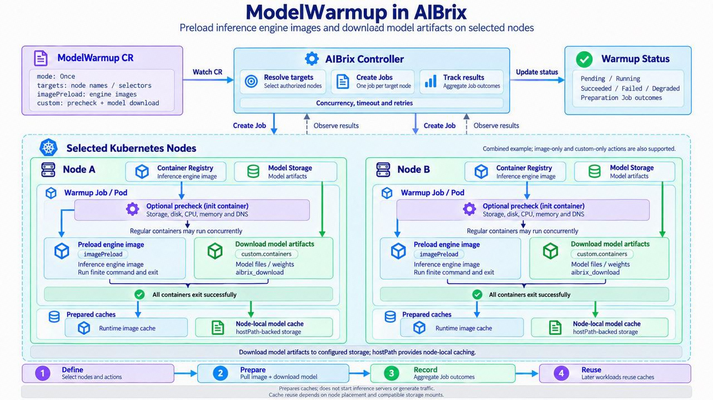

.. _model-warmup:

=================
Model Warmup
=================

.. warning::

   ModelWarmup is experimental. Its API and behavior may change in future
   releases.

``ModelWarmup`` supports a finite ``Once`` lifecycle and a long-lived
``Continuous`` lifecycle on selected Kubernetes nodes. A resource can be
image-only, custom-only, or combined:
image entries make the runtime pull an image and run a safe finite command;
custom actions can check a node or download an artifact; a combined action does
both. It does not start an inference engine or gate workloads.

Workflow and data flow
----------------------

.. mermaid::

   flowchart LR
      CR[ModelWarmup CR] --> T[Resolve explicit nodes and selectors]
      T --> R[Calculate Job-template revision]
      R --> I[Run custom init containers sequentially]
      I --> C[Run image and custom regular containers]
      C --> A[Aggregate per-node Job results in status]
      A --> OK[Succeeded, Failed, or Degraded]

Every target receives a node-pinned Job. Custom init containers run in their
declared order. Once they succeed, the controller-generated image containers
and ``custom.containers`` are regular containers and may run concurrently. All
of them must terminate successfully for that node Job to succeed. ``status``
remains an aggregate observation of the generated Jobs rather than a separate
per-container execution API.

.. _model-warmup-targeting:

Targeting and execution
-----------------------

Targets can combine explicit node names and non-empty label selectors. The
controller takes their union and deduplicates nodes. While a ``Once`` operation
is not terminal, Node create and label events add newly matched nodes. After
Succeeded, Failed, or Degraded, later nodes are ignored.

``Continuous`` keeps reconciling the current authorized target set. A newly
matching Node receives a Job, while a Node that leaves the selector or
authorization boundary has its owned Job removed. Coverage is identified by
the Node UID, so a replacement Node with the same name is warmed again. A Node
that leaves and later rejoins also starts a new coverage cycle.

The namespace and target nodes must share the
``resource-pool.aibrix.ai/name`` label, and nodes must opt in with
``model.aibrix.ai/warmup-enabled=true``. Control-plane nodes are excluded.
``parallelism`` limits simultaneously active Jobs, and ``jobTimeoutSeconds``
applies after a Job is created. ``retryLimit`` and
``ttlSecondsAfterFinished`` bound retry and retention behavior.

This authorization applies to both lifecycle modes. If the Namespace has no
non-empty resource-pool label, matching Nodes are not authorized. ``Once``
reports unavailable or unauthorized configured targets and does not reopen
after reaching a terminal phase. ``Continuous`` remains ``Pending`` with
``Ready=False`` and reason ``NamespacePoolNotConfigured``; after the label is
added or corrected, it automatically resolves the current targets. If Nodes
exist but their names, pool labels, or warmup opt-in do not authorize them, the
Continuous Ready condition uses ``TargetsUnavailableOrUnauthorized``. Inspect
both sides of the authorization boundary with:

.. code-block:: bash

   kubectl get namespace <namespace> --show-labels
   kubectl get nodes -L resource-pool.aibrix.ai/name,model.aibrix.ai/warmup-enabled

Continuous aggregate status covers only the currently resolved and authorized
set. If some explicit names are missing or unauthorized while other targets
resolve, those names are excluded from ``desiredNodes`` and do not prevent
``Ready``; this differs from Once, which reports them as failed targets. Verify
explicit names and authorization labels when the reported desired count is
lower than the configured list.

For ``Continuous``, ``retryLimit`` still controls retries inside one Kubernetes
Job. ``continuousRetryLimit`` controls the number of additional Jobs after a
terminal failure, and ``continuousRetryIntervalSeconds`` controls the fixed
delay between those attempts, from 1 second through 604800 seconds (7 days).
Automatic retries stop after that budget is exhausted. Deleting the retained
failed Job explicitly starts a new bounded retry cycle.

Successful Continuous Jobs are retained as the per-Node coverage record and
must not use ``ttlSecondsAfterFinished``. Deleting a retained successful Job
requests a replay. ``Ready`` means all current targets have succeeded;
``lastConvergedTime`` records the most recent transition into Ready, and
``completionTime`` remains unset. Pending, running, and failed target details
remain bounded even when aggregate counters cover a larger target set.
Each current target retains one Job and its completed Pod, so a 1,000-Node
Continuous warmup can hold roughly 1,000 Jobs and 1,000 Pods and may consume
namespace object or Pod quotas.

ModelWarmup does not infer tolerations from the target Node. A Node with a
``NoSchedule`` or ``NoExecute`` taint remains subject to normal Kubernetes
scheduling policy. Image-only actions request no GPU, while a custom container
can explicitly request a device such as ``nvidia.com/gpu``.

API fields
----------

``spec.imagePreload.images`` accepts image, command, optional args, and pull
policy. Every image entry needs a command that exits safely after the image is
pulled. ``spec.custom`` accepts the following Pod-template fragments:

.. code-block:: yaml

   custom:
     initContainers: []       # finite, sequential node checks
     containers: []           # finite regular actions
     volumes: []              # declared volume sources used by the actions
     imagePullSecrets: []     # pull credentials for custom images

Container names must be unique across generated image containers and custom
containers, and volume mounts must name a declared ``custom.volumes`` entry.
At least one image preload or custom regular container is required; init-only
actions cannot complete a ModelWarmup by themselves.

Examples
--------

The image-only sample is unchanged and remains compatible with the original v1
behavior:

.. literalinclude:: ../../../../samples/modelwarmup/modelwarmup.yaml
   :language: yaml
   :linenos:

The Continuous sample keeps a resource pool covered as Nodes join or are
replaced:

.. literalinclude:: ../../../../samples/modelwarmup/continuous.yaml
   :language: yaml
   :linenos:

Each image-only entry must use a command that exits successfully without
starting the inference server. The BusyBox sample uses ``sh -c "exit 0"``.
For the public ``vllm/vllm-openai`` image, its CLI can print help and exit:

.. code-block:: yaml

   imagePreload:
     images:
     - image: vllm/vllm-openai:<version-or-digest>
       command: ["vllm", "serve"]
       args: ["--help=all"]

Verify the command against the exact image tag or digest before creating a
ModelWarmup; other engines and distroless images may expose different binaries.

``model-download.yaml`` is custom-only. It uses the public
``aibrix/runtime:v0.8.0`` image to run ``aibrix_download`` for the small public
``sshleifer/tiny-gpt2`` artifact and writes it to a node-local cache:

.. literalinclude:: ../../../../samples/modelwarmup/model-download.yaml
   :language: yaml
   :linenos:

``node-precheck.yaml`` checks cache write access and at least 1 GiB free space.
``gpu-precheck.yaml`` runs ``nvidia-smi`` with an ``nvidia.com/gpu: "1"``
limit and therefore requires a GPU node with the NVIDIA device plugin.

Two large, opt-in examples combine real engine images with a
``Qwen/Qwen3-0.6B`` download. Their init containers verify writable storage,
10 GiB free disk, two CPUs, 4 GiB available memory, and Hugging Face DNS:

.. literalinclude:: ../../../../samples/modelwarmup/vllm-qwen-warmup.yaml
   :language: yaml
   :linenos:

.. literalinclude:: ../../../../samples/modelwarmup/sglang-qwen-warmup.yaml
   :language: yaml
   :linenos:

The examples preload pinned vLLM or SGLang images while the custom regular
container downloads the model into a separate node-local cache. Restrict the
selector to the intended nodes; two nodes are sufficient for a smoke test.
They prepare caches only and do not start an inference server. See the sample
directory README for apply commands and prerequisites.

.. _model-warmup-model-cache:

Prepare model caches for ModelClaim
-----------------------------------

Use ``aibrix_download --prepare-cache`` in a custom action to prepare files
for an unchanged :ref:`ModelClaim <modelclaim>`. Download metadata is a general
capability of the existing downloader, not a separate Warmup service. With
``AIBRIX_MODEL_CACHE_METADATA_DIR`` configured, ordinary successful AIBrix
downloads also register their results while still returning the original path.
Metadata publication is best-effort for ordinary downloads; explicit cache
preparation requires it to succeed.

The runtime reads this shared metadata, checks registered files locally, and
reports URL hints through its existing ``cached_artifacts`` snapshot field.
The controller can then prefer a cached warm Pod among candidates that satisfy
its existing capacity and pool constraints. ModelWarmup success alone does not
mean a model is ready to serve, and metadata does not replace the loader's
remote freshness checks.

Connect an existing warm pool
^^^^^^^^^^^^^^^^^^^^^^^^^^^^^

Use preparation and runtime images that include this capability. Keep the
pool's existing cache settings, mounts, credentials, and endpoint configuration.
The only new environment variable needed to enable registration and discovery
is ``AIBRIX_MODEL_CACHE_METADATA_DIR``. Point it at a writable directory shared
by the preparation Job and the runtime on the same node.

For the existing HF warm-pool sample, reuse its ``hf-cache`` volume and add:

.. code-block:: yaml

   - name: AIBRIX_MODEL_CACHE_METADATA_DIR
     value: /root/.cache/huggingface/.aibrix/download-metadata

This path uses the sample's existing node directory
``/var/cache/aibrix/huggingface``. Do not add or override ``HF_HUB_CACHE`` or
``DOWNLOADER_LOCAL_DIR``, or add unused backend volumes, merely to enable
metadata. If the pool already has nondefault cache settings, make the Job use
those settings and the same underlying files. Apply environment changes through
the pool's normal rollout procedure; running Pods do not pick them up
without replacement.

Reuse the namespace/node authorization described in :ref:`model-warmup-targeting`.
Prepare on the authorized worker nodes that host eligible warm Pods. Nodes in
the same resource pool do not automatically share files. A container-local
cache must be made accessible to both Pods before cross-Pod reuse can work;
sharing metadata alone does not share model weights.

Run preparation and verify discovery
^^^^^^^^^^^^^^^^^^^^^^^^^^^^^^^^^^^^

The following example uses the existing HF cache mount. Build and distribute
the referenced preparation image from a source version containing this feature,
and use a matching runtime version in the warm pool:

.. literalinclude:: ../../../../samples/modelwarmup/model-cache.yaml
   :language: yaml
   :linenos:

Apply the sample and wait for its finite preparation Job to complete:

.. code-block:: bash

   kubectl apply -f samples/modelwarmup/model-cache.yaml
   kubectl -n default wait --for=condition=Complete \
     modelwarmup/prepare-qwen-cache --timeout=30m

Discovery is asynchronous and normally refreshes every 10 seconds. Before
expecting cache-aware placement, read the runtime snapshot and check that
``cached_artifacts`` contains the exact model URL used by the Claim:

.. code-block:: bash

   kubectl -n default exec deployment/warm-runtime-pool -- python3 -c \
     'import urllib.request; print(urllib.request.urlopen("http://127.0.0.1:8080/v1/runtime/snapshot").read().decode())'

Once the URL is reported, apply the original Claim without adding a Warmup
reference, local path, or revision field:

.. code-block:: bash

   kubectl apply -f samples/modelclaim/modelclaims.yaml
   kubectl -n default get modelclaims -w

The preparation sample covers ``Qwen/Qwen3-0.6B``. The two-model Claim sample
also requests ``Qwen/Qwen2.5-0.5B-Instruct``; prepare that model separately if
you want both models cached ahead of demand. Otherwise it follows the normal
on-demand loading path. A cache hint never bypasses insufficient GPU capacity.

Other sources and behavior
^^^^^^^^^^^^^^^^^^^^^^^^^^

The same command supports all existing downloader backends. Keep the matching
cache and metadata directories available to both preparation and consumption:

.. code-block:: bash

   aibrix_download --prepare-cache --model-uri huggingface://Qwen/Qwen3-0.6B
   aibrix_download --prepare-cache --model-uri s3://my-bucket/releases/model-a
   aibrix_download --prepare-cache --model-uri tos://my-bucket/releases/model-b
   aibrix_download --prepare-cache --model-uri gcs://my-bucket/releases/model-c

HF also accepts ``hf://`` and bare repository IDs; GCS also accepts ``gs://``.
HF preparation uses the existing Hub client in native cache mode. S3, TOS, and
GCS retain their existing downloader destinations and ETag/size checks, so their
normal source credentials and metadata requests remain necessary. This feature
does not promise offline loading. ``--local-dir`` overrides only the producer's
root; it must agree with the runtime's existing effective cache location.

``--prepare-cache`` requires an unfiltered source and a configured metadata
directory. Ordinary downloads with suffix filters remain supported, but their
records are not advertised as complete caches. No user-supplied commit SHA is
required. Nondefault HF revisions can be recorded, but only a snapshot selected
by the local ``refs/main`` is advertised as a default repo hint. Cache hints do
not freeze upstream references or provide exact-version scheduling.

Metadata describes the current download's files using cache-relative paths and
file fingerprints. It does not infer a model family or prove engine compatibility
or cryptographic integrity. Missing or changed registered files withdraw new
hints; ordinary loading keeps its existing behavior. Metadata is not a weight
copy, and deleting a Claim or Warmup does not delete the shared files.

If no new hint appears, check the Job result and runtime logs, the effective
metadata directory and cache mounts in both Pods, file permissions, and matching
source settings. A disabled metadata variable preserves historical download
behavior. Runtime discovery reads registered results rather than inventorying
unregistered HF caches; legacy served markers remain compatible. HF downloads
performed directly inside an engine do not pass through the AIBrix registration
hook.

Security and cache durability
-----------------------------

The namespace-to-node resource-pool label plus explicit node opt-in form the
scheduling authorization boundary. They do not make arbitrary custom actions
safe. Custom actions receive exactly the volumes, images, and resource requests
declared in the resource, so creation permission is sensitive. Use
least-privilege RBAC and dedicated target pools; restrict who can create
ModelWarmups that use ``hostPath`` or privileged settings.

Automatic service-account token mounting is disabled, but explicit projected
``serviceAccountToken`` volumes are allowed and use the Pod's service account
permissions (normally the namespace default service account). Secret volumes can
also expose namespace credentials. Keep service-account permissions minimal and
restrict which token and secret volumes ModelWarmup authors may request.

ModelWarmup admission does not perform full native Job/Pod validation. If the
API server rejects Job creation, the controller logs the error and requeues it.
With no Job to inspect, bounded Job diagnostics and ModelWarmup failure status
may not record that rejection; check controller logs when progress stalls.

A Job can also be accepted while admission rejects every Pod that it tries to
create. For example, a namespace enforcing the ``restricted`` Pod Security
standard can reject an image-only warmup because its generated containers do
not set every required security-context field. The Job then has no Pods, and
the target can report ``Running`` until ``jobTimeoutSeconds`` expires. Inspect
the Job and its ``FailedCreate`` events to find the admission message:

.. code-block:: bash

   kubectl -n <namespace> describe job <job-name>
   kubectl -n <namespace> get events \
     --field-selector involvedObject.kind=Job,involvedObject.name=<job-name>

Use ``spec.custom.containers`` when the action needs an explicit
``securityContext`` that satisfies namespace policy. Image-only entries do not
expose that field. Alternatively, run the warmup in a namespace whose admission
policy permits the generated Pod template.

The bundled cache samples use ``hostPath`` at ``/var/lib/aibrix/models`` with
``DirectoryOrCreate``. That exposes a node filesystem path to the Job and may
be disallowed by Pod Security admission. The samples do not require privileged
containers; do not broaden privilege, host networking, PID namespaces, or host
mount scope solely to run them.

``Succeeded`` and ``Ready`` are point-in-time aggregate Job results. Kubelet or runtime image
garbage collection can evict pulled images, and node replacement, cleanup, or
storage failures can remove host-path model artifacts. Use immutable image and
model references when reproducibility matters, and retain a durable artifact
source for production workloads.

Labels and annotations
----------------------

.. list-table:: ModelWarmup metadata keys
   :header-rows: 1

   * - Key
     - Object
     - Purpose
   * - ``resource-pool.aibrix.ai/name``
     - Namespace and Node
     - Authorizes a Node only when its non-empty pool value equals the
       ModelWarmup namespace pool value. Cluster administrators manage it.
   * - ``model.aibrix.ai/warmup-enabled``
     - Node
     - A value of ``true`` explicitly opts the Node into warmup scheduling.
   * - ``model.aibrix.ai/warmup``
     - Job
     - Controller-managed label containing the owning ModelWarmup UID.
   * - ``model.aibrix.ai/warmup-name``
     - Job
     - Controller-managed annotation containing the human-readable ModelWarmup
       name.
   * - ``model.aibrix.ai/revision``
     - Job
     - Controller-managed label identifying the immutable workload revision.
   * - ``model.aibrix.ai/target-node``
     - Job
     - Controller-managed annotation recording the exact authorized target
       Node name.
   * - ``model.aibrix.ai/target-node-uid``
     - Job
     - Controller-managed annotation recording the target Node identity used
       by Continuous coverage.
   * - ``model.aibrix.ai/attempt``
     - Job
     - Controller-managed, one-based Continuous Job attempt. Users do not set
       these Job metadata keys.

Scope
-----

The spec is immutable after creation; create another resource to change an
action, selector, or lifecycle policy. Separate pipeline stages, arbitrary lifecycle hooks, workload or
rollout gating, autoscaler mutation, and workload-derived targets remain out of
scope. Custom actions are finite Job work, not a general-purpose deployment or
orchestration framework.
Deleting and recreating a Continuous resource deletes its owned coverage
ledger and warms every currently authorized target again.
