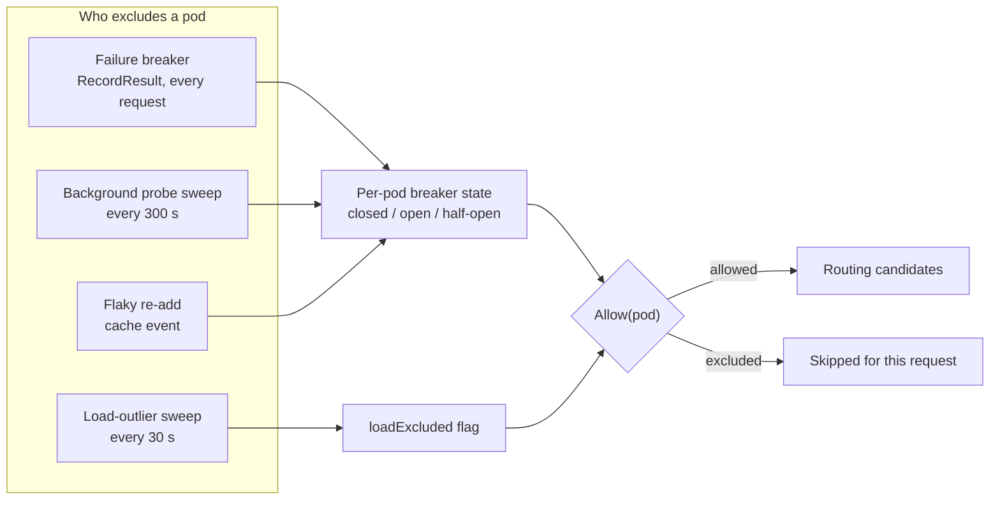
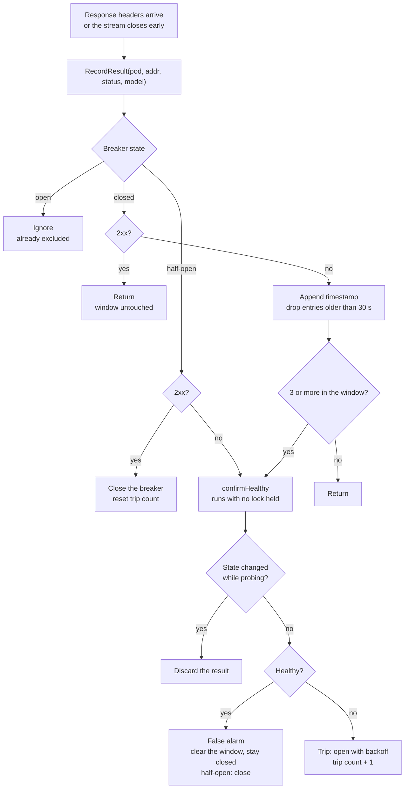
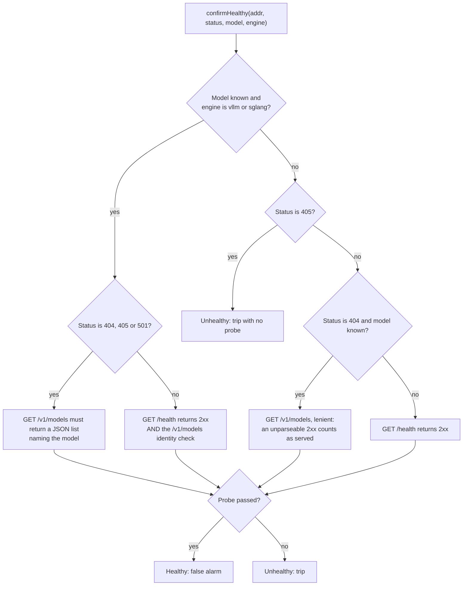
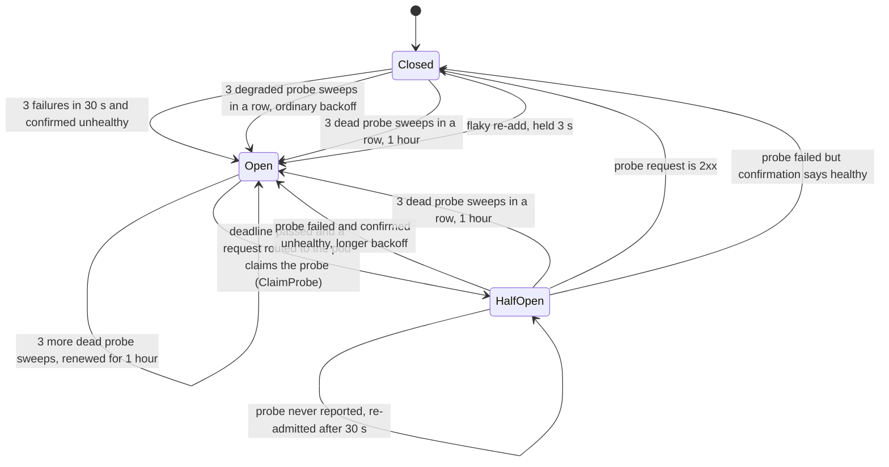
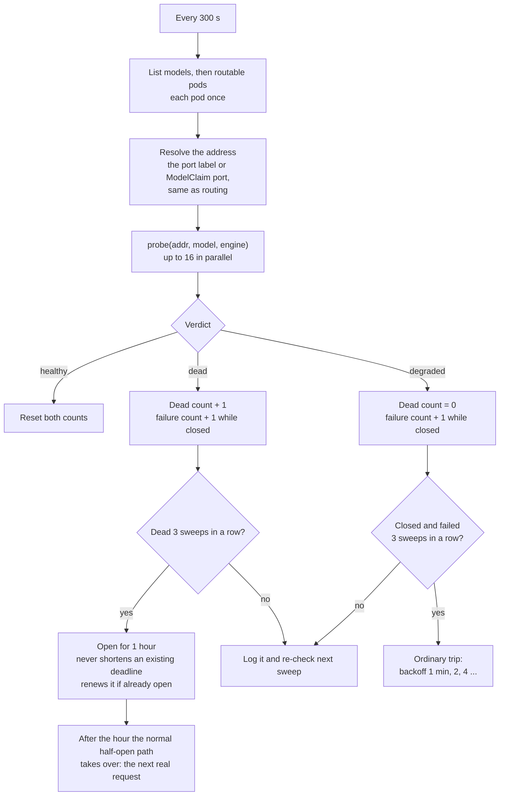

# Pod blacklist

How the gateway stops routing to a pod that is broken, overloaded, or no longer the engine it was registered as.

This directory is the Go package `blacklist`: the per-pod circuit breaker, its background sweeps and their tests. It does not depend on `gateway.Server`.

## Enablement

The feature is **off by default**. Set `AIBRIX_POD_BLACKLIST_ENABLED=true` (or `1`) on the gateway to turn on the whole stack together: failure breaker, background probe sweep, load-outlier sweep, flaky re-add and quarantine. There are no per-policy toggles. Unset, empty, `false` or `0` leaves every exported method a no-op and starts no background work, so healthy-fleet routing matches the pre-blacklist path. See [ENV_VARS.md](../ENV_VARS.md#pod-blacklist-blacklist).

| File | Role |
|---|---|
| [`pod_blacklist.go`](pod_blacklist.go) | `PodBlacklist`, the per-pod circuit breaker: `Allow`, `ClaimProbe`, `RecordResult`, `confirmHealthy`, `RecordProbeResult`, `OnPodFlakyReAdd`; master switch `AIBRIX_POD_BLACKLIST_ENABLED` |
| [`pod_probe_sweep.go`](pod_probe_sweep.go) | The background probe sweep (every 300 s): `StartProbeSweep` |
| [`pod_load_blacklist.go`](pod_load_blacklist.go) | The load-outlier sweep (every 30 s): `StartLoadOutlierSweep` |
| [`../gateway_blacklist.go`](../gateway_blacklist.go) | Server-side glue: starts the sweeps, supplies the cache and queue-depth function, forwards `OnPodFlakyReAdd`, registers the blacklist as the cache's quarantine checker, reports early-closed ext_proc streams (`recordUncompletedRecv`) |
| [`../gateway_rsp_headers.go`](../gateway_rsp_headers.go) | Reports the upstream status from the response headers (`RecordResult`) |
| [`../gateway.go`](../gateway.go) | Reports the `-1`/`-2` sentinels when the ext_proc stream closes early (`handleRecvError`), and filters candidates (`FilterBlacklisted`) |
| [`../gateway_req_body.go`](../gateway_req_body.go) | Claims the half-open probe for the pod the router picked (`claimBlacklistProbe`, which calls `ClaimProbe`) |

**Wiring.** `Server` holds a `blacklist.PodBlacklist` by value; the zero value is ready to use. The sweeps take two small interfaces instead of `Server`: `blacklist.PodSource` (`ListModels`, `ListPodsByModel`; `cache.Cache` satisfies it) and `blacklist.QueueDepthFunc`. The probe hooks `HealthCheck`, `ModelCheck` and `IdentityCheck` are exported fields, so tests can replace the HTTP probes. When `AIBRIX_POD_BLACKLIST_ENABLED` is on, `NewServerWithOptions` starts the sweeps and registers the server with the cache as its pod lifecycle listener and the blacklist as its quarantine checker, each only if the cache implements the matching optional registry (`cache.PodLifecycleRegistry`, `cache.PodQuarantineRegistry`). While the switch is off those steps are skipped. `Shutdown` undoes both. The quarantine checker is a single slot shared by everything using the cache, so `Shutdown` clears it only if it still holds this server's blacklist.

## The whole picture

A pod is excluded from routing for one of four reasons. Three of them drive the same per-pod breaker; the load-outlier flag is separate. Routing reads both through `Allow(pod)`.



Exclusion is a soft preference. If every ready pod of a model is excluded, the gateway routes across all of them rather than fail the request.

State is **per gateway process**, held in memory. With several gateway replicas each one counts failures and excludes pods on its own, and a restart starts from an empty state.

## 1. Failure breaker (request driven)

Every request routed to a pod reports its outcome through `RecordResult`.

**Failure:** any non-2xx outcome. The sources are:

- A non-2xx upstream status in the response headers.
- Sentinel `-1` (`StatusStreamClosed`): the ext_proc stream closed before any response headers arrived while the client was still connected. If the client had left (the stream context is done), a client abort or timeout says nothing about the pod and nothing is recorded, so a pod so slow that clients give up before Envoy answers is not caught here.
- Sentinel `-2` (`StatusIncompleteStream`): the ext_proc stream closed after the response headers while the client was still connected (the upstream hung up mid-response). If the client had left, nothing more is recorded, since the headers already recorded the status. A success whose headers end the message (a 204, an empty-body 200) is complete, so closing the stream afterwards is not a failure.

Only the pod the request was routed to is blamed: a stream that closes before a pod was picked, or after the request completed, records nothing. A failure that shows only inside a 200 response body (an in-band error event, or a stream that ends without a terminator) is not detected.

A success does not clear the failure window.

**Threshold:** 3 failures inside a sliding 30 s window, not necessarily consecutive.



- Confirmation runs **on the request that trips the breaker**, so that request can wait up to 3 s per probe (6 s when both probes run). Failures that arrive while a probe is in flight each start their own probe.
- A failed half-open probe needs no threshold. It goes straight to confirmation.

### Confirmation: `confirmHealthy`

`GET /health` only proves that *some* process answers on the address. Under host networking a port can be recycled, so a stale registration may point at an unrelated listener that answers `/health` 200 and fails every inference request. For engines that list their models, the model list is therefore an **identity check**.



| Case | Why |
|---|---|
| 404, 405, 501, with the identity check | The listener rejects the route or the model. `/health` cannot disprove that, the model list can. A healthy engine that a client sent a wrong-method request to still lists its model, so it is a false alarm. |
| Other statuses, with the identity check | Need `/health` **and** identity. `/health` still catches an engine core that died behind a live API server, which `/v1/models` does not. |
| Engine not `vllm`/`sglang`, or no model name | The identity check cannot run (the engine's `/v1/models` may have another shape), so the older rules apply: 405 trips on count alone, 404 with a model uses the lenient model list, everything else uses `/health`. |

**The identity check** (`httpEngineIsModelServer`) is `GET /v1/models` read strictly: a 2xx whose body parses as `{"data":[{"id":...}]}` with one `id` equal to the requested model. An empty or non-JSON 2xx means "not this engine". The engine comes from the pod's `model.aibrix.ai/engine` label.

**Fail-open (do not trip) vs fail-closed (trip):**

| Probe | Fail-open | Fail-closed |
|---|---|---|
| `/health` | Empty address, request construction error | Transport error, non-2xx |
| `/health`, `xllm` pod | Empty address, request construction error, **any HTTP response** (xLLM answers 404 on `/health` while serving) | Transport error only |
| `/v1/models`, lenient | Empty address or model, construction error, unparseable 2xx | Transport error, non-2xx, model not listed |
| `/v1/models`, identity | Empty address or model, construction error | Transport error, non-2xx, **empty or non-JSON 2xx**, model not listed |

## 2. Breaker states



**Backoff** doubles per consecutive trip: 1 min, 2, 4, 8, then capped at 10 min. A successful half-open probe resets the trip count. A pod the probe sweep finds dead is blacklisted for **1 hour** instead (section 4).

**The half-open probe is a real client request.** A pod that is still bad costs one failed request per backoff period, which is why a dead pod is moved to the 1 hour blacklist.

## 3. Routing gate: `Allow` and `ClaimProbe`

`FilterBlacklisted` calls `Allow` on every ready candidate before the routing algorithm runs. It does no network work, and while no pod has an entry at all (a healthy fleet) it returns the candidates untouched without a lookup or an allocation:

| Pod state | `Allow` returns |
|---|---|
| No entry, or closed | true |
| `loadExcluded` set | false (checked first; the breaker's timers are not advanced meanwhile) |
| Open, before its deadline | false |
| Open, backoff elapsed | true. The pod is a candidate; the breaker does not change. |
| Half-open, deadline not passed | false |
| Half-open, deadline passed | true. The pod is a candidate; the breaker does not change. |

`Allow` does not touch the breaker. The half-open probe is claimed separately, by `ClaimProbe`, **for the pod the router picked**. `HandleRequestBody` calls it once the request is certain to be sent to that pod, after the replica in-flight check that can still reject it. Claiming on candidacy would spend the probe on every candidate the router then passed over, and keep each of them out of routing until the probe reports back or the 30 s deadline lapses.

| Pod state | `ClaimProbe` |
|---|---|
| No entry, or closed | false |
| Open, before its deadline | false (routing fell back to an excluded pod because every pod was excluded; this request is not a probe) |
| Open, backoff elapsed | true. The pod becomes half-open with a 30 s probe deadline, and this request is the probe. |
| Half-open, deadline not passed | false (a probe is in flight) |
| Half-open, deadline passed | true (fresh deadline) |

The claim is not atomic with the candidate check. A burst of requests that arrive between a pod's backoff ending and the first claim can each be routed to it, so a recovering pod may see a few requests rather than exactly one. From the claim on, `Allow` excludes it again, and whichever of those requests reports first settles the breaker.

`IsBlacklisted` is the read-only variant. It reports a pod only while it is load-excluded or open before its deadline, so half-open pods, and open pods whose backoff has elapsed, are not reported.

## 4. Background probe sweep

The request-driven breaker only sees pods that are being sent traffic. The sweep also catches a pod that went bad while idle, a stale registration whose engine is gone, and one whose address now belongs to another process.

Every **300 s** it probes every routable pod once, except prefill and decode pods (the `role-name` label is `prefill` or `decode`), which the sweep never probes. A pod serving several models, such as a base model and LoRA adapters, is probed once, against its own served model. Pods that are already open or half-open are probed too. Probing uses the same definition of healthy as confirmation (`probe`) and gives one of three verdicts:

| Verdict | When | After 3 sweeps in a row |
|---|---|---|
| **Dead** | `GET /health` fails (transport error or non-2xx; for an `xllm` pod, transport error only), **or** for a `vllm`/`sglang` pod with a known model, `GET /v1/models` answers 2xx with an empty or non-JSON body | Blacklists the pod for **1 hour**, whatever state its breaker is in |
| **Degraded** | `/health` is fine but `GET /v1/models` is not 2xx or is a JSON list without the model (a reload in progress looks like this) | If the breaker is closed, trips it with the ordinary backoff: 1 minute, doubling |
| **Healthy** | Everything passes | Nothing; a healthy sweep restarts both counts |



- **Consecutive means consecutive.** A healthy sweep restarts both counts, and a degraded sweep restarts the dead count. Three failing sweeps that are not all dead still trip the ordinary breaker, so that pod gets one minute, not an hour. Detection takes about 10 minutes from the first failure (3 sweeps, 5 minutes apart). To act on the first failed sweep, change the `podProbeFailureIterations` constant to 1.
- **A dead pod stays out while it stays dead.** It keeps being probed, and every further 3 dead sweeps renew the hour. After the last renewal it comes back an hour later through the half-open path, which costs at most one real request per hour per replica.
- **The sweep never lifts a blacklisting early**, even if the pod recovers. A healthy sweep only restarts the counts. The stale-entry pruning also counts `podBlacklistEntryTTL` from the later of the entry's last update and its `openUntil`, so a quiet, recovered pod's block is not cut short.
- **A pod blacklisted this way is quarantined.** `IsQuarantined(pod)` is true for exactly this one-hour block (not for an ordinary backoff, a load exclusion or a flaky re-add). The gateway registers the blacklist with the cache (`Server.registerPodQuarantine`), and the cache then, for that pod: does not scrape its `/metrics` and does not emit its `model_replicas` series (the existing stale-series cleanup removes the one already emitted). The pod stays in the cache, and the sweep still probes it (that is what renews the hour). When the hour ends the metrics loops pick it up again. The metrics last scraped stay in the cache's metric store, so routing across an all-excluded model still has a value to read for it. The per-pod engine gauges already exported (`num_requests_running` and the like) keep their last value until the pod is scraped again; nothing deletes them, so a dashboard shows them flat for the hour. The load-outlier sweep (section 5) does not read those frozen values: it leaves a quarantined pod out of its peer set.
- **Stale registrations** that were already cycling through short open/half-open backoffs are moved to the hour, so they stop receiving a real request every few minutes.

## 5. Load-outlier flag and flaky re-add

- **Load outlier.** Every 30 s, each model with at least 3 ready pods is scored on engine-reported running plus waiting requests. A pod is flagged when it is more than 2 standard deviations above the mean of its *peers* (the other pods, not the group including itself) **and** at least `AIBRIX_LOAD_OUTLIER_MIN_GAP` (default 16) above it. The flag has no backoff or probe: the first sweep that finds the pod back in range clears it. It is independent of the breaker. A pod that serves several models is flagged if any of them scores it an outlier. A quarantined pod (section 4) is left out entirely: the cache no longer scrapes it, so its load is as old as the quarantine and would skew its peers' mean and standard deviation. It does not count toward the 3-pod minimum, and the sweep neither sets nor clears its flag until the quarantine ends. A pod that is load-excluded, or in an ordinary backoff, is still scraped and is still scored.
- **Flaky re-add.** When the cache sees a pod reappear at the same IP after being absent for at least 250 ms (and less than the 60 s a deleted pod's counters are kept for), `OnPodFlakyReAdd` opens the breaker for 3 s without confirming anything, and the first request after that is the half-open probe. The in-place pod update the informer handles as a delete and re-add in one call is not a flaky re-add. The trip count is left alone. A pod that is already open keeps the later deadline, and a half-open pod is not disturbed.

## Constants

| Constant | Value | Meaning |
|---|---|---|
| `FailureThreshold` | 3 | Failures within the window before confirmation |
| `podBlacklistFailureWindow` | 30 s | Sliding failure window |
| `podBlacklistBaseDuration` / `podBlacklistMaxDuration` | 1 min / 10 min | Backoff start and cap |
| `podBlacklistProbeTimeout` | 30 s | A claimed half-open probe expires after this |
| `podHealthCheckTimeout` | 3 s | Timeout per request of a confirmation probe (a tripping request waits for it) |
| `podProbeTimeout` | 5 s | Timeout per request of a sweep probe. Longer because nothing waits on the sweep and a slow pod is not a dead one: `/health` on the sglang pods takes 1.4-1.7 s |
| `podHealthCheckPath` / `podModelsCheckPath` | `/health` / `/v1/models` | Probe paths |
| `podProbeSweepInterval` | 300 s | Background sweep period |
| `podProbeFailureIterations` | 3 | Consecutive failed (or dead) sweeps before the sweep acts |
| `podProbeDeadBlacklistDuration` | 1 h | How long the sweep blacklists a pod it found dead |
| `podProbeConcurrency` | 16 | Probes in flight during one sweep |
| `flakyReAddOpenDuration` | 3 s | Hold after a flaky re-add |
| `podBlacklistEntryTTL` / `podBlacklistSweepInterval` | 30 min / 5 min | An entry is pruned once it has been untouched this long, counted from the later of its last update and its `openUntil` |
| `loadOutlierCheckInterval` | 30 s | Load-outlier sweep period |
| `loadOutlierStdDevThreshold` | 2.0 | Standard deviations above the peer mean |
| `loadOutlierMinPods` | 3 | Fewest ready pods for a model to be scored |
| `AIBRIX_POD_BLACKLIST_ENABLED` (env) | `false` | Master switch for the whole feature (see [Enablement](#enablement) and [ENV_VARS.md](../ENV_VARS.md#pod-blacklist-blacklist)) |
| `AIBRIX_LOAD_OUTLIER_MIN_GAP` (env) | 16 | Minimum absolute running+waiting gap over the peer mean (see [ENV_VARS.md](../ENV_VARS.md#pod-blacklist-blacklist)); only used when the master switch is on |

## Operating it

**Turn it on.** Set `AIBRIX_POD_BLACKLIST_ENABLED=true` on every gateway replica that should exclude broken or overloaded pods. Restart (or roll) the gateway so the process picks up the env var. Leave it unset or `false` for the pre-blacklist routing path.

**See what is excluded.** There is no query endpoint; read the log lines below. State is per replica, so look at the log of the replica that served the request.

**Log lines** (all through the gateway log). Each one that names a pod also gives the ip:port and model it is reached on, as `pod ns/name (addr=ip:port, model=name)` (or `addr` and `model` fields in the structured ones), so a line can be matched to a curl command. Lines from a request use the address it was routed to; the sweeps and other background paths derive it from the pod.

| Message contains | Level | Meaning |
|---|---|---|
| `blacklisted for … confirmed unhealthy` | Warning | The failure breaker tripped |
| `hit … failures … treating as a false alarm` | Info | Threshold reached, confirmation said healthy |
| `passed its half-open probe and is un-blacklisted` | Info | Recovered |
| `failed its half-open probe with a failure status, but … false alarm` | Info | Half-open probe failed, confirmation said healthy, breaker closed |
| `failed its half-open probe … re-blacklisted` | Warning | Still bad, longer backoff |
| `pod failed a background probe; it will be re-checked` | Info | Sweep failure 1 or 2 for a pod whose breaker is closed |
| `excluded pod failed a background probe as dead; it will be re-checked` | Info | Dead sweep 1 or 2 (`deadSweeps=`) for a pod that is already open or half-open. Without it an excluded pod is silent until the sweep that blacklists it for an hour. Degraded sweeps of such a pod are not logged. |
| `blacklisted for 1h0m0s: background probe found it dead … sweeps in a row` | Warning | The sweep found the pod dead and blacklisted (or renewed) it for an hour |
| `blacklisted for …: background probe failed … sweeps in a row` | Warning | The sweep tripped a degraded pod with the ordinary backoff |
| `pod proactively excluded pending health confirmation` | Info | Flaky re-add |
| `pod flagged as a load outlier` | Info | Every load sweep while the pod is an outlier, with the peer mean, stddev and gap |
| `blacklisted: running+waiting request count is a statistical outlier` | Warning | The pod became load-excluded |
| `pod un-blacklisted: running+waiting request count has converged` | Info | The pod left load exclusion, with the `gateway_total` and `engine_total` it was judged on |

**Tests:**

```
go test ./pkg/plugins/gateway/blacklist/
go test ./pkg/plugins/gateway/ -run 'Blacklist|handleRecvError|selectTargetPod'   # the Server-side wiring
```

## Known limitations

- Counts and exclusions are per gateway replica, so a bad pod has to fail on a replica before that replica excludes it.
- Confirmation probes run synchronously on the tripping request (section 1).
- If the confirmation probe is slow because the pod is overloaded, a healthy pod can still be judged unhealthy. The sweep waits up to 5 s per request (`podProbeTimeout`), but a tripping request cannot afford that wait. So a pod whose `/health` takes longer than 3 s is always reported unhealthy by the confirmation after 3 failing requests, and those requests trip an ordinary backoff whatever the pod's real state. The sglang pods answer in about 1.5 s, inside the limit.
- A stale registration is only fully fixed at the source: the registration side should deregister the endpoint or verify identity. The blacklist limits the damage, and the sweep finds it without traffic.
- A failure that only shows inside a 200 response body is not detected: neither an in-band error event in a stream nor a stream that ends without its terminator reaches the breaker. Only the response status and an ext_proc stream closing early do.
