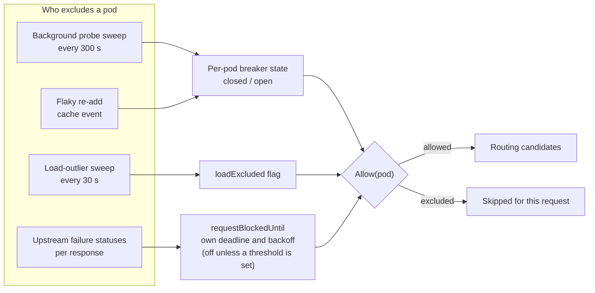
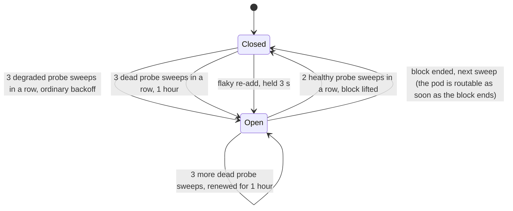
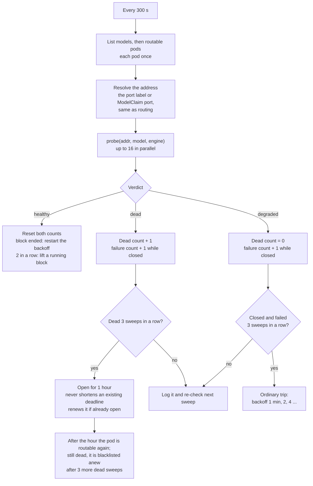

# Pod blacklist

How the gateway stops routing to a pod that is broken, overloaded, or no longer the engine it was registered as.

This directory is the Go package `blacklist`: the per-pod exclusion list, its background sweeps and their tests. It does not depend on `gateway.Server`.

## Enablement

The feature is **off by default**. Set `AIBRIX_POD_BLACKLIST_ENABLED=true` (or `1`) on the gateway to turn on the stack: background probe sweep, load-outlier sweep, flaky re-add and quarantine. The request-failure source is the exception: it is **opt-in on top of that**, and stays off until `AIBRIX_POD_BLACKLIST_REQUEST_FAILURE_THRESHOLD` is set above `0` (section 5), so turning the blacklist on for the probe sweep does not also turn on ejection by response status. Unset, empty, `false` or `0` leaves every exported method a no-op and starts no background work, so healthy-fleet routing matches the pre-blacklist path. The per-request load-imbalance gate (`ApplyLoadImbalanceGate`) is separate and runs with the blacklist on or off: it narrows the pods the blacklist left (section 4). See [ENV_VARS.md](../ENV_VARS.md#pod-blacklist-blacklist).

**What counts as a request failure is narrow.** Only the HTTP status of an upstream response does, and only a 502, 503 or 504 (section 5), and only once the source is turned on. A 500, a 4xx, a 429, an ext_proc stream that closes early (EOF or cancel) and a client that gives up neither blame nor exclude the pod, because the gateway cannot tell them from an upstream failure or they are not evidence against the pod. A success never creates an entry. With the source on, a pod that answers `/health` and `/v1/models` but fails requests with 502, 503 or 504 is excluded by it, not by the sweeps; one that fails them with a 500 is not found by either.

| File | Role |
|---|---|
| [`pod_blacklist.go`](pod_blacklist.go) | `PodBlacklist`, the per-pod exclusion list: `Allow`, `RecordResponse`, `RecordProbeResult`, `SetLoadExcluded`, `OnPodFlakyReAdd`, `probe`; master switch `AIBRIX_POD_BLACKLIST_ENABLED`, the request-failure threshold `AIBRIX_POD_BLACKLIST_REQUEST_FAILURE_THRESHOLD` and the exclusion cap `AIBRIX_POD_BLACKLIST_MAX_EXCLUDED_PERCENT` |
| [`pod_blacklist_metrics.go`](pod_blacklist_metrics.go) | The Prometheus metrics (see Metrics) |
| [`pod_ignore.go`](pod_ignore.go) | `ignoredPod`: the pods the blacklist never tracks (StormService pods, prefill, decode and encode pods, ModelClaim pods) |
| [`pod_probe_sweep.go`](pod_probe_sweep.go) | The background probe sweep (every 300 s): `StartProbeSweep` |
| [`pod_load_blacklist.go`](pod_load_blacklist.go) | The load-outlier sweep (every 30 s): `StartLoadOutlierSweep` |
| [`../gateway_blacklist.go`](../gateway_blacklist.go) | Server-side glue: starts the sweeps, supplies the cache and queue-depth function, forwards `OnPodFlakyReAdd`, reports a response's status to the blacklist (`recordPodResponse`), registers the blacklist as the cache's quarantine checker, applies the all-excluded and over-the-cap fallback, logs it and the un-blacklist line |
| [`../gateway.go`](../gateway.go) | Filters candidates (`FilterBlacklisted`) in `selectTargetPod`; calls `recordPodResponse` when the response headers arrive |

**Wiring.** `Server` holds a `blacklist.PodBlacklist` by value; the zero value is ready to use. The sweeps take two small interfaces instead of `Server`: `blacklist.PodSource` (`ListModels`, `ListPodsByModel`; `cache.Cache` satisfies it) and `blacklist.QueueDepthFunc`. The probe hooks `HealthCheck` and `IdentityCheck` are exported fields, so tests can replace the HTTP probes. When `AIBRIX_POD_BLACKLIST_ENABLED` is on, `NewServerWithOptions` starts the sweeps and registers the server with the cache as its pod lifecycle listener and the blacklist as its quarantine checker, each only if the cache implements the matching optional registry (`cache.PodLifecycleRegistry`, `cache.PodQuarantineRegistry`). While the switch is off those steps are skipped. `Shutdown` undoes both. The quarantine checker is a single slot shared by everything using the cache, so `Shutdown` clears it only if it still holds this server's blacklist.

## Pods the blacklist ignores

Three kinds of pod are never tracked, whatever the probe verdicts say (`ignoredPod`):

- **Pods created by a StormService**, recognised by the `storm-service-name` label the StormService controller puts on every pod it renders. They are the prefill, decode and encode pods of a disaggregated deployment, which the PD router handles per role and RoleSet instead of by excluding one pod.
- **Prefill, decode and encode pods**, by the `role-name` label (`prefill`, `decode` or `encode`), whoever created them. The PD router pairs the roles within a RoleSet, so excluding every pod of one role leaves it nothing to pair while ready pods exist, which the blacklist's fallback (it only covers a model with nothing left, or too little) does not help with. The probe sweep never probed them either, and the load sweep and flaky re-add now leave them alone as well.
- **Pods that carry a ModelClaim binding**, recognised by an annotation with the prefix `route.claim.model.aibrix.ai/`. A warm pod runs one engine per claimed model, each on its own port. A verdict about the pod would mix those engines: one dead engine would take the healthy ones on the same pod out of routing.

What that means for each kind of deployment:

| Pods | Protected by the blacklist | Where the filter sees them |
|---|---|---|
| Plain engine pods (no StormService, role or ModelClaim) | Yes, by every source | Filtered on every strategy |
| Prefill and decode pods (PD) | No, never tracked | The PD strategy filters the whole ready list first and admits them; the PD router handles failures per role |
| Encode pods (E+PD) | No, never tracked | Split off before the filter on every strategy except PD, and handed to the encode stage as they are; the PD strategy keeps them in the list it filters, and admits them |
| StormService pods | No, never tracked | Filtered like any other list entry, and always admitted |
| ModelClaim pods | No, never tracked (the blacklist does not key by endpoint) | Always admitted |

A request can therefore mix both kinds. A model whose pods are all ignored behaves as if the blacklist were off. This is deliberate rather than an oversight: for a pod that is part of a RoleSet the PD router, not a per-pod verdict, decides what is still usable.

For such a pod `RecordResponse`, `RecordProbeResult`, `SetLoadExcluded` and `OnPodFlakyReAdd` do nothing and create no entry, so `Allow` always admits it and it is never quarantined. The probe sweep does not probe it, and the load-outlier sweep leaves it out of both the scoring and the peer baseline (it does not count toward the 3-pod minimum either). The check is made when a verdict is recorded, so a pod that gains a ModelClaim annotation later keeps any entry it already had until the 30-minute pruning removes it; warm pods are not routed to before they hold a claim, so this does not arise in practice.

## The whole picture

A pod is excluded from routing for one of four reasons. Two of them drive the same per-pod breaker (open or closed); the load-outlier flag and the request-failure block are separate, each with its own state, so one never lifts or resets another. Routing reads all of them through `Allow(pod)`.



Exclusion is a soft preference. If every ready pod of a model is excluded, the gateway routes across all of them rather than fail the request.

State is **per gateway process**, held in memory. With several gateway replicas each one probes and excludes pods on its own, and a restart starts from an empty state.

## 1. Breaker states



**Backoff** doubles per consecutive trip: 1 min, 2, 4, 8, then capped at 10 min. A pod the probe sweep finds dead is blacklisted for **1 hour** instead (section 3).

**No request probes a recovering pod.** There is no half-open state: when a block ends the pod is a routing candidate again (`Allow` goes by the deadline), and the next sweeps decide. (A block the request-failure source put on a pod is separate, with its own probation: section 5.) The breaker is moved back to closed by whichever sweep result or flaky re-add comes next (`lapseLocked`). A healthy sweep after the block has ended also resets the trip count, so a recovered pod is not punished for its earlier block. A block that has **not** ended is lifted by `podProbeRecoveryIterations` (2) healthy sweeps in a row, a quarantine included (section 3); a request-failure block is not lifted by sweeps. A pod that is still degraded or dead takes traffic until the sweeps block it again, which needs another 3 failing sweeps in a row (about 10 minutes). For a degraded pod that backoff is the next, longer one.

## 2. Routing gate: `Allow`

`FilterBlacklisted` calls `Allow` on each pod it is given, before the routing algorithm runs. It does no network work. While no entry can exclude its pod (`excluded`, an exact count of the entries that are open, load-excluded or blocked by request failures, is zero) it returns the pods untouched without a lookup or an allocation, so a pod that has failed one probe, whose entry excludes nothing, does not put every request on the per-pod path. The count has no clock: it counts an open breaker even after its block has ended, so it can only over-count what `Allow` rejects, never under-count it, and `Allow` and `IsBlacklisted` answer from one deadline-aware check (`blocksLocked`). An entry whose block has ended stays counted, and keeps requests on the per-pod path, until the next probe result for the pod closes it or the 5-minute prune does; the prune is what ends it for a pod that has left the fleet and is no longer probed. When it does look, it allocates only if it finds a pod to drop. An entry is created only by a failed sweep probe, a load exclusion, a flaky re-add or an upstream failure status, never by a success: `RecordResponse` returns before it builds a key while nothing is tracked, so a healthy fleet allocates nothing per response.

`Allow` only reads. It takes the entry's read lock, so one request never waits for another to finish with a pod's entry, and it does not count as a touch: an entry that routing keeps looking at but nothing changes ages out after `podBlacklistEntryTTL` like any other. The read lock's counter is still shared, so many goroutines asking about the same pod at once cost on the order of 100 ns each (measured: about 130 ns per call with 12 goroutines on one pod). What keeps routing cheap is not the lock but the `excluded` gate above, and with the candidate stage looking at K pods rather than all of them.

Which pods it is given depends on the candidate stage (`AIBRIX_ROUTING_CANDIDATE_K`, see [ENV_VARS.md](../ENV_VARS.md#candidate-stage-algorithmscandidatesgo)). When the stage narrows a request to K pods, `selectTargetPod` filters those K pods after the stage picks them, so the lookups per request stay at K however many pods are ready or tracked. A few excluded candidates are dropped without replacement; if all K are excluded and other ready pods are not, the stage runs again over the ready pods that are not excluded. The exclusive strategies (`pd`, `slo*`) see every ready pod, so for them the whole ready list is filtered, ahead of the stage. A request with a replica-inflight limit is filtered like any other: the blacklist's filter runs on the K candidates, then the inflight filter (`narrowToInflightCapacity`, which also reads only the candidates) runs on what is left, so it never sees an excluded pod. If every ready pod is excluded, or too many are, the request routes to them anyway (next).

| Pod state | `Allow` returns |
|---|---|
| No entry, or closed | true |
| Entry for another pod UID | true (checked first) |
| `loadExcluded` set | false (checked before the breaker) |
| Open, before its deadline | false |
| Open, deadline passed | true |
| Blocked by request failures, before its deadline | false |
| Blocked by request failures, deadline passed | true (on probation, section 5) |

`IsBlacklisted` is the read-only variant. It reports a pod only while it is load-excluded, open before its deadline, or blocked by request failures before its deadline.

An entry belongs to the pod UID it was observed on. A pod deleted and recreated under the same name (a StatefulSet replica, or a pod recreated by hand) has a new UID and is a new pod: `Allow`, `IsBlacklisted`, `IsQuarantined` and `BlacklistReason` ignore the old pod's entry for it. The first sweep result, load verdict, response or flaky re-add for the new pod starts the entry over, which takes the old pod's exclusion off `excluded` and the excluded-pods gauge (within one 30 s load sweep for a ready pod). That is not reported as a recovery.

**The exclusion cap.** The blacklist may exclude at most `AIBRIX_POD_BLACKLIST_MAX_EXCLUDED_PERCENT` (default 50) of the pods a request considers. Past that, `selectTargetPod` routes the request across all of them as if none were excluded, and counts it (`gateway_pod_blacklist_fallback_total{reason="over_cap"}`, with a throttled `too many pods are blacklisted` log line). It is the same fallback as for a model with every pod excluded, extended to most of them: the few pods left would carry all the model's traffic, and a verdict wrong for many pods at once (a network fault on the gateway's side, a probe path that something changed) is more likely than most of a fleet failing together. At the default one pod of two, two of four and three of eight may be excluded; two of three may not. A model with a single pod therefore never excludes it. `100` turns the cap off: only a model with every pod excluded falls back. With the candidate stage the cap is judged on the K candidates a request is given. When they are over it but the ready pods as a whole are not, the stage runs again over the pods that are not excluded; when the ready pods are over it too, the request goes across the candidates. Near the cap a sample can fall either side by chance, so some requests keep their exclusions and some do not.

## 3. Background probe sweep

The sweep is the only thing that looks at a pod's health. It catches a pod that went bad, a stale registration whose engine is gone, and one whose address now belongs to another process, whether or not the pod is being sent traffic.

Every **300 s** it probes every routable pod once, except the pods the blacklist ignores (see above: prefill, decode and encode pods among them), which the sweep never probes. A pod serving several models, such as a base model and LoRA adapters, is probed once, against its own served model. Pods that are already open are probed too. A probe (`probe`) gives one of three verdicts:

| Verdict | When | After 3 sweeps in a row |
|---|---|---|
| **Dead** | `GET /health` fails (transport error, or non-2xx for a `vllm`/`sglang` pod; any other engine only has to answer at all), **or** for a `vllm`/`sglang` pod with a known model, `GET /v1/models` answers 2xx with an empty or non-JSON body | Blacklists the pod for **1 hour**, whatever state its breaker is in |
| **Degraded** | `/health` is fine but `GET /v1/models` is not 2xx, is a JSON list without the model (a reload in progress looks like this), or did not arrive in time | If the breaker is closed, trips it with the ordinary backoff: 1 minute, doubling |
| **Healthy** | Everything passes | Nothing; a healthy sweep restarts both counts, and 2 in a row lift a block that is still running |

`GET /health` only proves that *some* process answers on the address. Under host networking a port can be recycled, so a stale registration may point at an unrelated listener that answers `/health` 200 and serves nothing. For engines that list their models (`vllm`, `sglang`; the engine comes from the pod's `model.aibrix.ai/engine` label), the model list is therefore an **identity check**: `GET /v1/models` must be a 2xx whose body parses as `{"data":[{"id":...}]}` with one `id` equal to the pod's model.

**Fail-open (healthy) vs fail-closed (failed):**

| Probe | Fail-open | Fail-closed |
|---|---|---|
| `/health`, `vllm` or `sglang` pod | Empty address, request construction error | Transport error, non-2xx |
| `/health`, any other engine or no engine label | Empty address, request construction error, **any HTTP response** (xLLM answers 404 on `/health` while serving and xDiT has no such route) | Transport error only |
| `/v1/models` | Empty address or model, construction error | Transport error, non-2xx, model not listed, a body that did not arrive in time or was cut off (all degraded); **empty or non-JSON 2xx** (dead) |

An engine joins the strict `/health` list, and the identity check, once its behaviour has been verified; until then a pod is only required to answer. The probe goes through an HTTP client with a transport of its own and no proxy: `http.DefaultTransport` would honour `HTTP_PROXY`, and a proxy that cannot reach the pod network answers like a dead pod.



- **Consecutive means consecutive.** A healthy sweep restarts both counts, and a degraded sweep restarts the dead count. Three failing sweeps that are not all dead still trip the ordinary breaker, so that pod gets one minute, not an hour. Detection takes about 10 minutes from the first failure (3 sweeps, 5 minutes apart). To act on the first failed sweep, change the `podProbeFailureIterations` constant to 1.
- **A dead pod stays out while it stays dead.** It keeps being probed, and every further 3 dead sweeps renew the hour.
- **A healthy pod does not serve out the hour.** A single healthy sweep only restarts the counts (and the trip count once the block has ended), but `podProbeRecoveryIterations` (2) healthy sweeps in a row lift a block that is still running, a quarantine included, so the cache scrapes the pod again. A failing sweep in between starts that count over, so a pod that flaps does not leave on one lucky probe. A load exclusion is not a sweep block: only the load sweep clears it. The stale-entry pruning counts `podBlacklistEntryTTL` from the later of the entry's last update and its `openUntil`, so a quiet, recovered pod's block is not cut short.
- **A pod blacklisted this way is quarantined.** `IsQuarantined(pod)` is true for exactly this one-hour block (not for an ordinary backoff, a load exclusion or a flaky re-add). The gateway registers the blacklist with the cache (`Server.registerPodQuarantine`), and the cache then, for that pod: does not scrape its `/metrics` and does not emit its `model_replicas` series (the existing stale-series cleanup removes the one already emitted). The pod stays in the cache, and the sweep still probes it (that is what renews the hour). When the hour ends the metrics loops pick it up again. The metrics last scraped stay in the cache's metric store, so routing across an all-excluded model still has a value to read for it. The per-pod engine gauges already exported (`num_requests_running` and the like) keep their last value until the pod is scraped again; nothing deletes them, so a dashboard shows them flat for the hour. The load-outlier sweep (section 4) does not read those frozen values: it leaves a quarantined pod out of its peer set.

## 4. Load-outlier flag and flaky re-add

- **Load outlier.** Every 30 s, each model with at least 3 ready pods is scored on engine-reported running plus waiting requests. A pod is flagged when it is more than 2 standard deviations above the mean of its *peers* (the other pods, not the group including itself) **and** at least `AIBRIX_LOAD_OUTLIER_MIN_GAP` (default 16) above it. The flag has no backoff or probe: the first sweep that finds the pod back in range clears it. It is independent of the breaker. A pod that serves several models is flagged if any of them scores it an outlier. A pod with no measurement (it joined after the last scrape, or its metrics are missing) is left out of that model's scoring: it is not scored, is not a peer, and does not count toward the 3-pod minimum, because read as load 0 it would drag its peers' mean down and flag the one pod carrying the traffic. A pod that loses its measurement is no longer flagged. A pod that leaves the cache (deleted, scaled down, or no longer served under any model) is never scored again, so the sweep clears its flag itself, which takes it out of `excluded` and the excluded-pods gauge within a sweep; it is not reported as a recovery. A pod that is still listed but not scored (quarantined, or not ready) keeps its flag. A sweep in which some model's pods could not be listed clears nothing. A pod the blacklist ignores (see above) is left out like a quarantined one: never flagged, not a peer, and not counted toward the 3-pod minimum. A quarantined pod (section 3) is left out entirely: the cache no longer scrapes it, so its load is as old as the quarantine and would skew its peers' mean and standard deviation. It does not count toward the 3-pod minimum, and the sweep neither sets nor clears its flag until the quarantine ends. A pod that is load-excluded, or in an ordinary backoff, is still scraped and is still scored.
- **The load-imbalance gate is separate.** The gateway's per-request load-imbalance gate (`ApplyLoadImbalanceGate`, see [load_balance.md](../algorithms/load_balance.md)) narrows a request to the least-loaded pods from the gateway's live running counts. It runs whether or not the blacklist is on, and is not replaced by this sweep: the blacklist removes the pods it excludes first, and the gate then narrows the pods that are left. The sweep sees engine-side queueing and reacts only once per sweep; the gate reacts on every request.
- **Flaky re-add.** When the cache sees a pod reappear at the same IP after being absent for at least 250 ms (and less than the 60 s a deleted pod's counters are kept for), `OnPodFlakyReAdd` opens the breaker for 3 s without checking anything, and the pod is routable again after that. The in-place pod update the informer handles as a delete and re-add in one call is not a flaky re-add. The trip count is left alone. A pod that is already open keeps the later deadline.

## 5. Request failures

`RecordResponse(pod, status)` is called once per request, when the upstream's response headers arrive (`Server.recordPodResponse`, from `handleProcessingRequest`), with the pod the request was routed to. It is the only place the gateway reports how a request went, and it reads the HTTP status, nothing else.

**What counts against a pod** (`IsPodFailureStatus`): a **502, 503 or 504** in the response headers the gateway receives, whoever sent it: an engine that is shedding or has lost its backend, a sidecar or proxy in front of it that cannot reach it, a request that timed out there. What does **not** count, and so does not block a pod, however many arrive:

| Not counted | Why |
|---|---|
| 500 | The status engines return for a request-induced exception (a guided-decoding or grammar bug, a multimodal decode failure, a tool-call parser error). A client can shape it: one tenant's deterministic 500s, retried onto the same pod by prefix-cache routing, would eject pods that serve everyone else fine. The cost: an engine that answers **every** request with 500 while `/health` passes is found by neither this source nor the sweeps |
| Any other 5xx | None of them says a pod cannot serve right now. 501 in particular says the engine does not implement the route, a matter of configuration for every request |
| 4xx | The request's fault, not the pod's: a pod that answers 400 is alive |
| 429 | Load, which every replica of the model shares; excluding for it moves traffic onto the pods least able to take it |
| The ext_proc stream ending (EOF, cancel, a gRPC error) | Envoy half-closes **and** resets the stream when a downstream client leaves, so the gateway cannot tell a client that gave up from an upstream failure. Nothing is recorded in `handleRecvError` |
| A 2xx that breaks mid-body | The headers said success. Detecting it needs Envoy's response flags, which the gateway does not request (see the limitations) |

**Deployment prerequisites and what the source cannot see.** The source reads the response headers ext_proc receives, so:

- The ext_proc **response header mode must be `SEND`**. That is Envoy's default, and the shipped manifests keep it (the Helm Envoy config sets it explicitly; the `EnvoyExtensionPolicy` objects set only body modes). A custom chain that sets `SKIP` turns the source off without an error.
- **A response Envoy generates itself never arrives.** On the pinned Envoy (`envoyproxy/envoy:v1.33.2` in all four install paths) ext_proc is skipped for Envoy's own local replies (the runtime guard `envoy.reloadable_features.skip_ext_proc_on_local_reply` defaults to true): a connection refused, a reset before any response, a route timeout. Reviewers reproduced this on a live cluster and against a standalone Envoy: those 503s and 504s reach the client but not `RecordResponse`. The probe sweep, not this source, is what finds a pod that refuses connections, at the sweep's pace (minutes), and while it is the only backend the all-excluded fallback still routes to it. The source therefore counts statuses the engine, or a proxy in front of it, sent. Turning that runtime guard off delivered the local replies in the reviewers' control run, but it changes ext_proc behaviour for every local reply, and as reported in review the skip exists because of a security fix; that is a decision for the deployment, with its own end-to-end test, so this package does not assume it and the shipped manifests do not set it.
- Attribution is to the pod the request was **routed to** (`TargetPod`). A deployment that retries at the route (a `BackendTrafficPolicy` with retries, say) could charge a retried 503 to the pod of the first attempt. That is untested here.

**The rule.** `AIBRIX_POD_BLACKLIST_REQUEST_FAILURE_THRESHOLD` (default `0`, which is off) failures **in a row** block the pod. Any other response from it, a 4xx, a 429 and a 500 included, starts the count over, as does a pause of more than `requestFailureStreakGap` (1 minute) between two failures, so failures minutes apart on a pod with little traffic never add up. Resetting on any response keeps the rule simple and flap-resistant, and it has a cost: a pod that alternates failures with successes (503, 200, 503, 200) never reaches a threshold above 1. A failure *rate* over a window, with a floor on the number of samples, would catch it; that is the shape #3390 proposes, and this source does not do it yet. The first block lasts the ordinary backoff, 1 minute, and each further one doubles it up to 10 minutes (`backoffDuration`). There is no confirmation probe: nothing waits on the request path, and nothing is sent to a pod that is already failing.

```mermaid
stateDiagram-v2
    [*] --> Counting
    Counting --> Counting: a response that is not a failure (count restarts)
    Counting --> Blocked: threshold failures in a row (backoff 1, 2, 4, 8, 10 min)
    Blocked --> Blocked: responses while blocked (ignored: in flight when it began)
    Blocked --> Probation: the block ends (no probe request; routable again)
    Probation --> Blocked: one failure (next, longer backoff)
    Probation --> Counting: 10 responses in a row that are not failures, or 20 min without a block (backoff starts over)
```



- **In-flight requests do not stack.** A response that arrives while the pod is already excluded, by any source, is ignored: those requests were routed before the block began, and counting them would escalate the backoff for one incident. The same goes for successes, which must not count towards a recovery that has not begun. This holds under concurrency: many requests finishing at once on a busy pod make one block (tested with 32 goroutines).
- **Probation.** When a block ends the pod is routable again with no probe. The block's trip count is kept, and **one** more failure blocks it again at once, with the next backoff, rather than needing the full threshold. `podRequestRecoverySuccesses` (10) responses in a row that are not failures end the probation and start the backoff over, and so does `requestTripDecay` (20 minutes, twice the longest backoff) without a block, counted from the end of the last one: at low traffic ten clean responses can take longer than a pod should stay one stray failure from the 10-minute cap. The sweeps never end it: a healthy probe says nothing about inference. Both time bounds are applied when a response arrives, from timestamps only responses and blocks write, so the load sweep, which refreshes the entry's `lastUpdated` for every pod that has one, cannot keep a stale streak or a stale probation alive.
- **Independent of the probe breaker.** The block has its own deadline (`requestBlockedUntil`), trip count and reason, so a healthy sweep neither lifts it nor shortens its backoff, and a request block does not escalate the sweep's backoff. A pod that passes `/health` and `/v1/models` but fails every request is what this source is for. It is **not** quarantined: it answers, so the cache keeps scraping it. Healthy sweeps do not lift a request block even for the 8 and 10 minute steps, which are longer than two sweeps.
- **It cannot take the fleet out.** The block is a soft preference like the others: the exclusion cap (section 2) applies, so when more than `AIBRIX_POD_BLACKLIST_MAX_EXCLUDED_PERCENT` of a model's pods are excluded, or all of them, or the model has one pod, requests are routed across all of them. A fleet-wide failure, such as an upstream dependency that every replica shares, therefore does not become an outage of the gateway's own making.
- **Only a failure creates an entry**, and the entry ages out like any other (`podBlacklistEntryTTL` after the later of its last update and the end of its last request block), so probation state does not outlive its use.
- **State is keyed by namespace/name**, like every entry here. A pod recreated under the same name (a StatefulSet pod, say) inherits an active request block and its trip count until the block ends or the probation decays, at most 10 and 20 minutes. This is the keying the breaker has had since the probe sweep, which the flaky re-add relies on; it is bounded, and not changed here.
- **Ignored pods** (see above) are never recorded: prefill, decode and encode pods, StormService pods and ModelClaim pods. A PD request's target is its decode pod, so a 5xx from it would otherwise blame a pod for what may be the prefill leg's failure.

## Constants

| Constant | Value | Meaning |
|---|---|---|
| `podBlacklistBaseDuration` / `podBlacklistMaxDuration` | 1 min / 10 min | Backoff start and cap |
| `podProbeTimeout` | 5 s | Timeout per request of a sweep probe. Nothing waits on the sweep and a slow pod is not a dead one: `/health` on the sglang pods takes 1.4-1.7 s |
| `podHealthCheckPath` / `podModelsCheckPath` | `/health` / `/v1/models` | Probe paths |
| `podProbeSweepInterval` | 300 s | Background sweep period |
| `podProbeFailureIterations` | 3 | Consecutive failed (or dead) sweeps before the sweep acts |
| `podProbeRecoveryIterations` | 2 | Consecutive healthy sweeps that lift a block that is still running |
| `podProbeDeadBlacklistDuration` | 1 h | How long the sweep blacklists a pod it found dead |
| `podRequestRecoverySuccesses` | 10 | Responses in a row that are not failures that end a pod's probation after a request-failure block |
| `requestFailureStreakGap` | 1 min | Longest pause between two failures that still count as in a row; a longer one starts the count over |
| `requestTripDecay` | 20 min | How long after a request block ends its trip count is kept; past it the pod is off probation and the backoff starts over |
| `podProbeConcurrency` | 16 | Probes in flight during one sweep |
| `flakyReAddOpenDuration` | 3 s | Hold after a flaky re-add |
| `podBlacklistEntryTTL` / `podBlacklistSweepInterval` | 30 min / 5 min | An entry is pruned once it has been untouched this long, counted from the later of its last update and its `openUntil`. Each pass also closes a breaker whose block has ended, so it stops counting as excluded |
| `loadOutlierCheckInterval` | 30 s | Load-outlier sweep period |
| `loadOutlierStdDevThreshold` | 2.0 | Standard deviations above the peer mean |
| `loadOutlierMinPods` | 3 | Fewest ready pods for a model to be scored |
| `AIBRIX_POD_BLACKLIST_ENABLED` (env) | `false` | Master switch for the whole feature (see [Enablement](#enablement) and [ENV_VARS.md](../ENV_VARS.md#pod-blacklist-blacklist)) |
| `AIBRIX_POD_BLACKLIST_REQUEST_FAILURE_THRESHOLD` (env) | 0 (off) | Upstream failures in a row (502, 503, 504) that block the pod that served them; the request-failure source is opt-in and `0` leaves it off (see [section 5](#5-request-failures) and [ENV_VARS.md](../ENV_VARS.md#pod-blacklist-blacklist)) |
| `AIBRIX_POD_BLACKLIST_MAX_EXCLUDED_PERCENT` (env) | 50 | Most of the pods a request considers the blacklist may exclude; past it the request is routed across all of them. `100` turns the cap off (see [Routing gate](#2-routing-gate-allow) and [ENV_VARS.md](../ENV_VARS.md#pod-blacklist-blacklist)) |
| `AIBRIX_LOAD_OUTLIER_MIN_GAP` (env) | 16 | Minimum absolute running+waiting gap over the peer mean (see [ENV_VARS.md](../ENV_VARS.md#pod-blacklist-blacklist)); only used when the master switch is on |

## Operating it

**Turn it on.** Set `AIBRIX_POD_BLACKLIST_ENABLED=true` on every gateway replica that should exclude broken or overloaded pods. Restart (or roll) the gateway so the process picks up the env var. Leave it unset or `false` for the pre-blacklist routing path.

**See what is excluded.** There is no query endpoint; read the log lines below. State is per replica, so look at the log of the replica that served the request.

**Log lines** (all through the gateway log). Each one that names a pod also gives the ip:port and model it is reached on, as `pod ns/name (addr=ip:port, model=name)` (or `addr` and `model` fields in the structured ones), so a line can be matched to a curl command. The address is derived from the pod, as the sweeps and routing derive it.

| Message contains | Level | Meaning |
|---|---|---|
| `pod failed a background probe; it will be re-checked` | Info | Sweep failure 1 or 2 for a pod whose breaker is closed |
| `excluded pod failed a background probe as dead; it will be re-checked` | Info | Dead sweep 1 or 2 (`deadSweeps=`) for a pod that is already open. Without it an excluded pod is silent until the sweep that blacklists it for an hour. Degraded sweeps of such a pod are not logged. |
| `blacklisted for 1h0m0s: background probe found it dead … sweeps in a row` | Warning | The sweep found the pod dead and blacklisted (or renewed) it for an hour |
| `blacklisted for …: background probe failed … sweeps in a row` | Warning | The sweep tripped a degraded pod with the ordinary backoff |
| `blacklisted for …: N upstream failures in a row, last status …` | Warning | The request-failure source blocked the pod, with the backoff and the request trip number. Its end is not logged |
| `pod un-blacklisted: background probes found it healthy` | Info | `podProbeRecoveryIterations` healthy sweeps in a row lifted a running block |
| `pod briefly excluded after a flaky delete/re-add` | Info | Flaky re-add |
| `all ready pods are blacklisted; routing anyway` | Info | Every pod of a model is excluded; throttled to one line per model per 10 s |
| `too many pods are blacklisted; ignoring the blacklist for this request` | Info | More than the cap of the pods are excluded; throttled like the one above |
| `pod flagged as a load outlier` | Info | Every load sweep while the pod is an outlier, with the peer mean, stddev and gap |
| `blacklisted: running+waiting request count is a statistical outlier` | Warning | The pod became load-excluded |
| `pod un-blacklisted: running+waiting request count has converged` | Info | The pod left load exclusion, with the `gateway_total` and `engine_total` it was judged on |

A block that simply ends logs nothing.

**Metrics** (Prometheus, labelled with the model, the LoRA adapter and the gateway pod, never with the pod itself):

| Metric | Type | Labels | Meaning |
|---|---|---|---|
| `gateway_pod_blacklist_exclusions_total` | counter | `reason`: `probe_dead`, `probe_degraded`, `load_outlier`, `flaky_readd`, `request_failures`, `request_failures_probation` | A pod became excluded. Renewing a block, or a flap on a pod that is already excluded, is not counted again. A request block is `request_failures` the first time and `request_failures_probation` when the pod failed again on probation, so a pod that keeps coming back and failing shows apart from first trips. |
| `gateway_pod_blacklist_request_failures_total` | counter | `status`: `502`, `503`, `504`; `outcome`: `counted`, `ignored` | A failing status the request-failure source saw, by `model`. `counted` added to the pod's streak or blocked it; `ignored` arrived while the pod was already excluded (a request in flight when the block began). Only failures are emitted, never every response, and there is no pod label. Zero while upstream is failing says the source is not seeing it (see the deployment prerequisites in section 5), not that the fleet is healthy. |
| `gateway_pod_blacklist_recoveries_total` | counter | `reason`: `probe_healthy`, `load_recovered` | A pod's exclusion was lifted before its deadline |
| `gateway_pod_blacklist_probe_total` | counter | `verdict`: `healthy`, `degraded`, `dead` | Every probe the sweep sends. A burst of `dead` across a whole model is more likely a fault on the gateway's side than a fleet of dead pods. |
| `gateway_pod_blacklist_excluded_pods` | gauge | | Pods this gateway currently excludes, as of the end of the last sweep |
| `gateway_pod_blacklist_fallback_total` | counter | `reason`: `all_excluded`, `over_cap` | A request routed with the blacklist ignored. Counted for every request, not throttled like the log line. |

**Tests:**

```
go test ./pkg/plugins/gateway/blacklist/
go test ./pkg/plugins/gateway/ -run 'Blacklist|handleRecvError|selectTargetPod|UpstreamFailure|recordPodResponse'   # the Server-side wiring
```

## Known limitations

- Exclusions are per gateway replica, so each replica has to find a bad pod on its own sweeps before it excludes it.
- The sweep alone finds a pod in about 10 minutes (3 sweeps), and not one that answers `/health` and `/v1/models` correctly but fails inference. The request-failure source, **when turned on**, covers both within a handful of requests for a pod that takes traffic and fails with a 502, 503 or 504; a pod that is failing but is sent nothing is found only by the sweep, and one that fails with a 500 or with an Envoy-generated reply is found only by the sweep, if at all.
- The request-failure source is off by default because its policy is still open (#3390): which statuses are attributable, whether 429 should be counted apart, and whether a consecutive count or a failure rate over a window is the right estimator. It has not been measured on real traffic; the counters above are what an operator would watch when enabling it.
- The consecutive rule is easy to evade (any response that is not a failure resets it, so an intermittently failing pod never reaches a threshold above 1) and, below the streak gap, easy to reach at low per-pod traffic. Counting only 502, 503 and 504 takes away the case where one client's repeated bad requests do it; it does not make the rule a rate.
- Request failures are read from the response status alone. A stream that starts with 200 and then breaks, a client that leaves, and a request that never gets response headers are not recorded, so a pod that accepts requests and then hangs or resets them mid-stream is not found this way. Telling those apart needs Envoy's response flags (`response.flags`, `response.code_details`, which separate an upstream reset from a downstream close) requested through the ext_proc `response_attributes` setting; that is a gateway deployment change this source does not depend on.
- A 503 or 504 that comes from load, an engine that sheds requests when overloaded or a route timeout hit by a long generation, counts like a failure. Five in a row from one pod is what blocks it, and the exclusion cap and the fallback keep the fleet routable meanwhile, but a model that is overloaded everywhere will block pods up to the cap.
- Request-failure state is per gateway replica. With G replicas a pod at a fixed total traffic reaches the threshold on any one of them roughly G times more slowly; while a block runs, one replica excludes the pod and another keeps routing to it; each escalates its own backoff; and the exclusion cap is computed on each replica's own view, so across replicas the union of exclusions can exceed it. That matches the in-process first step #3390 describes, and `gateway_pod_blacklist_exclusions_total` per `gateway_pod` makes the divergence visible.
- A block that ends is not followed by a probe request. After a request-failure block the pod is on probation, so its next failure blocks it again at once; after a sweep block it takes traffic until the sweeps block it again (3 more failing sweeps in a row).
- A probe that cannot reach the pod for a reason of the gateway's own (a network problem on the gateway's side) looks like a dead pod. After 3 sweeps every pod so affected is blacklisted, and the cache stops scraping it. The exclusion cap keeps most of the fleet routable meanwhile, the `gateway_pod_blacklist_probe_total{verdict="dead"}` burst shows what happened, and 2 healthy sweeps lift it once the fault clears.
- A `/health` that takes longer than the sweep's wait (`podProbeTimeout`, 5 s) is judged dead; the sglang pods answer in about 1.5 s, inside the limit. A `/v1/models` body that does not arrive in time is degraded, not dead.
- Only `vllm` and `sglang` pods are required to answer `/health` with a 2xx, and have their model list checked. Any other engine is only required to answer, so a pod of one that is broken but still serving HTTP is not found by the sweep.
- A pod that is excluded between the filter and the router's pick is still routed to: the replica-inflight admission (`AdmitTarget`) does not re-check exclusion. Admission fails the request when it says no, and the blacklist is a soft preference that should not fail a request that has not itself failed. The window is the time between two steps of one routing decision.
- A stale registration is only fully fixed at the source: the registration side should deregister the endpoint or verify identity. The blacklist limits the damage, and the sweep finds it without traffic.
